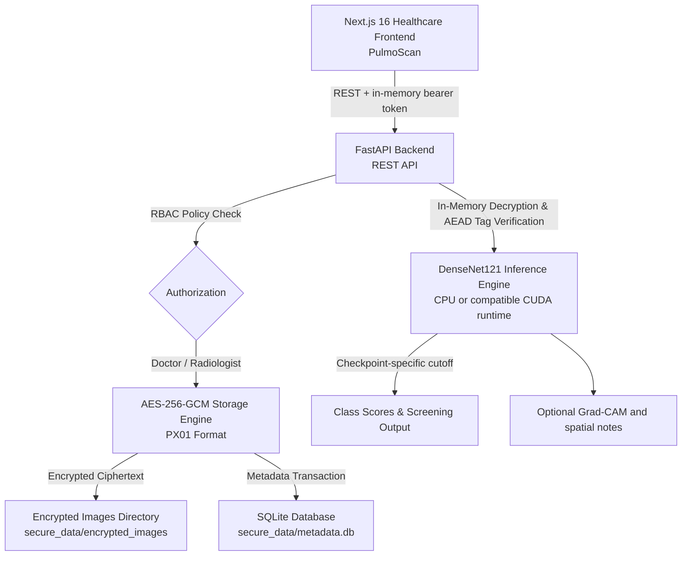

# PulmoScan: AI-Based Pneumonia Detection with Secure Storage & Transmission of Medical Data

PulmoScan is an academic prototype combining **pneumonia image classification, encrypted radiograph storage, and role-based practitioner access**. Staff upload a chest X-ray, request screening from a saved DenseNet121, and optionally inspect a Grad-CAM heatmap with linked image-region notes. Uploading never trains the model.

**Optional visual explanations:** after fresh screening, **Explain prediction** generates a Grad-CAM overlay with numbered image sections, linked plain-language notes, Original/Heatmap toggles, opacity, and enlarged viewing. See [explainability and verification](docs/EXPLAINABILITY.md). The notes describe relative score contributions in displayed-image coordinates; they do not identify medical findings, confirmed pneumonia locations, or improve model accuracy.

**Current scope (13 November 2026):** finish the existing screening prototype with image-linked Grad-CAM explanations. No new dataset, training run, or external language model is required. Finding detection and medical report generation are **deferred**. See the [project handoff and final review](docs/PROJECT_HANDOFF.md); the [future finding-model plan](docs/FINDING_MODEL_NEXT_STEPS.md) is retained only if the team revisits it.

**Final application checks:** [13 November fixes and verification](docs/FINAL_REVIEW_2026-11-13.md) cover session expiry, private responses, bounded uploads, dependency updates and CPU/CUDA regression checks. The maintained profiles use PyTorch 2.14.1 / torchvision 0.29.1; the application weights and threshold are unchanged.

**Patient workflow:** accessible scans are grouped by pseudonymous patient ID, with follow-up history, ID correction/deletion, and editable practitioner accounts. Patients have no logins. See [storage and model inventory](docs/PATIENT_WORKFLOW_AND_STORAGE.md).

**Scope:** this is educational screening software, not a clinically validated diagnostic device. Image scores are uncalibrated, and explanation text describes model contributions rather than medical findings. Kafka, Redis, Prometheus, Grafana, finding detectors and generated medical reports are not implemented.

## Current model and measured results

| Artifact | Role |
| --- | --- |
| `models/densenet121_pneumonia_best.pth` | Checked-in default DenseNet121; epoch 5, 224px stretch preprocessing, NORMAL=0 / PNEUMONIA=1, cutoff **0.40** |
| Kaggle v2 DenseNet121 under `data/experiments/` | Imported candidate; epoch 20, letterbox preprocessing, saved cutoff approximately **0.9999873**; not automatically activated |
| Kaggle v2 EfficientNet-B0 under `data/experiments/` | Imported candidate; epoch 16; requires serving support before use by the DenseNet-specific API |

The original default checkpoint SHA-256 is `5419fadee007300222c7f85e03bd2cb940fb2742864de5fe0b2be83c80bacd1f`. Check **Profile → Active model**, a fresh prediction's fingerprint or `/health/ready` for the bytes actually loaded. Configuration/file changes require a backend restart. Do not reuse one model's cutoff or preprocessing for another checkpoint.

The **Kaggle v2 DenseNet candidate**, not the default app model, reported **86.57% accuracy** on a previously reviewed 618-image benchmark: TN=150, FP=81, FN=2, TP=385. Raw-margin ROC-AUC was **0.97321**; probability ROC-AUC was **0.83648** under score saturation. These are dataset-specific historical results, not fresh external validation or guaranteed future accuracy. The experimental temperature profile is not loaded by the API. See [scoring and calibration](docs/CALIBRATION_AND_EXTERNAL_VALIDATION.md).

The teammate's exact original training GPU is not established. A `cuda:0` tensor tag does not prove RTX 3050 training. New predictions are forward passes using saved weights, not searches for a matching training image.

---

## System Requirements: Read Before Setup

These are practical baselines for running the frontend and backend locally with one-image screening. They are not certified hard minimums or multi-user server sizing guarantees.

| Component | CPU-only system | CPU + supported NVIDIA GPU |
|---|---|---|
| Processor | Modern 4-core Intel Core i5 / AMD Ryzen 5 class x86-64 CPU or better | Same; the CPU still handles the API, image decoding, and storage |
| System RAM | 8 GB baseline; 16 GB recommended with browser and development tools | 8 GB baseline; 16 GB recommended |
| Graphics | No dedicated GPU required; Intel/AMD integrated graphics are fine | At least 4 GB dedicated VRAM and a compatible NVIDIA driver; see GPU profiles below |
| Free SSD space | Plan for at least 20 GB for tools, dependencies, and caches | Plan for at least 30 GB for tools, CUDA wheels, and caches |
| Extra storage | Add space for uploaded images and any training dataset | Same |
| Supported installer platforms | Windows 10/11 64-bit or Linux x86-64 | Same |
| Software | Python **3.11**, Node.js **22+**, npm **10+** | Same; NVIDIA driver also required |

The existing **i5-11400H / GTX 1650 4 GB / 16 GB RAM** laptop meets this local-development baseline. A 512 GB SSD is sufficient in capacity; check free space rather than total capacity. The trained checkpoint is required for prediction; the training dataset is not.

### GPU compatibility and automatic CPU fallback

CUDA is NVIDIA technology. This setup accelerates compatible NVIDIA GPUs; AMD/Intel graphics use CPU. Apple Silicon/MPS, ROCm, Windows ARM, Jetson, and other ARM platforms are outside this installer's supported matrix. It does not claim support for every GPU ever released.

| Detected GPU family | Dependency profile | Conservative driver baseline: Windows / Linux |
|---|---|---|
| Turing, Ampere, Ada, Hopper: GTX 16, RTX 20/30/40 and matching workstation/datacenter GPUs; compute capability 7.5, 8.0, 8.6, 8.9, 9.0 | PyTorch `2.14.1+cu126`, torchvision `0.29.1+cu126` | `560.76+` / `560.28.03+` |
| Blackwell: RTX 50 and matching GPUs; compute capability 10.0 or 12.0 | PyTorch `2.14.1+cu130`, torchvision `0.29.1+cu130` | `580.88+` / `580.65.06+` |
| No NVIDIA GPU, older/unknown architecture, less than 4 GB VRAM, or insufficient driver | PyTorch `2.14.1+cpu`, torchvision `0.29.1+cpu` | No NVIDIA driver needed |

The setup helper checks actual GPU capability, VRAM, and driver rather than assuming any installed graphics card can run CUDA. These versioned profiles follow the [official PyTorch build matrix](https://pytorch.org/get-started/previous-versions/) and conservative toolkit-driver pairings from [NVIDIA CUDA 12.6](https://docs.nvidia.com/cuda/archive/12.6.0/cuda-toolkit-release-notes/index.html) and [the R580 driver notes for CUDA 13.0](https://docs.nvidia.com/datacenter/tesla/tesla-release-notes-580-65-06/index.html). Other GPU models in the same supported capability groups can qualify; successful execution is verified after installation. The Blackwell profile is provided for compatibility but has not been physically tested on this GTX 1650 laptop.

**Default behavior:** setup selects a matching CUDA build when a GPU qualifies; otherwise it selects CPU. If CUDA installation or its execution check fails, automatic setup attempts to restore CPU dependencies and reports the failure. At application startup, `PULMOSCAN_DEVICE=auto` tries a real GPU kernel and warms up the actual model; unavailable or unusable CUDA falls back to CPU with a warning. No packages or drivers are installed when starting the app. A runtime out-of-memory error during a later request is not silently retried on another device.

Leave `PULMOSCAN_DEVICE=auto` in `.env` for GPU preference with CPU fallback. Set it to `cpu` to force CPU, or `cuda` to require a GPU and fail clearly instead of falling back. Installing the standalone CUDA Toolkit is unnecessary for these prebuilt PyTorch wheels; a compatible NVIDIA driver is required. A CPU-only PyTorch installation cannot use a GPU until dependencies are changed.

On the GTX 1650 laptop, the CUDA 12.6 profile is installed. The configured original checkpoint and downloaded Kaggle v2 DenseNet candidate completed eight fixed-image prediction/Grad-CAM checks across `cuda:0` and forced CPU, without changing model state. This is an execution/regression check, not an accuracy benchmark. Other GPU profiles are covered by simulated selection tests; they have not all been physically tested. In containers or virtual machines, the GPU must also be exposed to that environment.

**Training is separate:** 16 GB system RAM is a starting point, with 32 GB more comfortable. The local profile uses batch 2 with accumulation 8 for a 4 GB GPU; larger physical batches are not guaranteed to fit. Around 8–12 GB VRAM gives more room. CPU training is supported but slower. Add dataset and checkpoint storage beyond the allowances above. Starting the web app never trains or modifies model weights.

---

## Architecture Overview



---

## Implementation and security boundaries

| Component | Current implementation |
| --- | --- |
| Backend | Python 3.11, FastAPI, Starlette, Pydantic, Uvicorn |
| Classification | PyTorch/torchvision DenseNet121; Pillow and NumPy preprocessing |
| Images | AES-256-GCM encrypted `.enc` copies under `secure_data/encrypted_images/` |
| Metadata | SQLite `secure_data/metadata.db`: scans, ownership, scores and practitioner accounts; the database file itself is **not encrypted** |
| Authentication | bcrypt hashes, HS256 JWTs, account-version revocation and database-backed role checks |
| Interface | Next.js 16.4.3, React 19.3.0, TypeScript, Tailwind CSS; light/dark appearance |
| Development/testing | Turborepo, Pytest, Vitest, React Testing Library |

Selecting a file initially creates a preview. Uploading sends its bytes and stores an encrypted copy; the source file is not moved, edited or monitored. Application uploads are separate from training data.

The default local connection is **HTTP on loopback**. Remote deployment needs configured and verified HTTPS/TLS; signed JWTs, AES storage, HMAC helper functions and an HSTS header do not themselves encrypt network traffic. HMAC utilities exist in the security module but are not a separate authenticated API transport protocol.

Uploads have an early body-size limit and an exact image-byte limit; decoding/encryption/storage use the worker pool. Multipart ingestion can still spool temporarily before encryption, so do not claim zero plaintext disk use. The model checks image format/dimensions, not whether an upload is truly a chest X-ray.

Sessions expire in memory and clear on matching protected-request 401 responses. API responses request no caching, limits bound authentication/inference traffic per process, and database/file identifiers are validated. These controls are not regulatory compliance or a production security certification. Docker deployment is not demonstrated by this checkout.

---

## Project Documentation Index

Use the current inventory, explanation, handoff and final-review guides first. Older audit, deployment and user-guide sections preserve earlier proposals/measurements; their presence does not establish completed Docker deployment, HTTPS configuration or clinical validation.

- [Current Storage, Patient Workflow and Model Inventory](docs/PATIENT_WORKFLOW_AND_STORAGE.md)
- [Grad-CAM Explanations and Their Limits](docs/EXPLAINABILITY.md)
- [Final Application Review and Verification](docs/FINAL_REVIEW_2026-11-13.md)
- [Handoff and Manual Review](docs/PROJECT_HANDOFF.md)
- [Local Setup and Turborepo Commands](docs/LOCAL_SETUP.md)
- [How the Model Works, CPU/GPU Selection & Hardware Requirements](docs/MODEL_AND_HARDWARE.md)
- [Dataset Download, Folder Layout & Training Preparation](docs/DATASET_SETUP.md)
- [Backend Review and Measured Model Baseline](docs/BACKEND_REVIEW.md)
- [Manual Training, Preprocessing, Logs & Resume](docs/TRAINING.md)
- [Complete User Guide, Page Map & RBAC Guide](USER_GUIDE_AND_ACCESS_CONTROL.md)
- [Security Audit Report](docs/SECURITY_AUDIT.md)
- [End-to-End Testing Report](docs/END_TO_END_TESTING.md)
- [Deployment Preparation & Operations Guide](docs/DEPLOYMENT.md)
- [API Documentation](docs/API_DOCUMENTATION.md)
- [Secure Storage Cryptography Specification](docs/SECURE_STORAGE.md)
- [Frontend Documentation](frontend/README.md)
- [Frontend Appearance and UX Review](docs/FRONTEND_UX.md)

---

## Local Setup and Running the Application

Follow the [complete setup guide](docs/LOCAL_SETUP.md) for prerequisites, creating `.venv`, installing Python and Node dependencies, and generating local configuration. The same steps are included in [section 10 of the user guide](USER_GUIDE_AND_ACCESS_CONTROL.md#10-local-setup--execution-guide-windows-powershell).

From the project root, create an environment if needed, install dependencies for the detected hardware, and create local configuration:

```powershell
py -3.11 -m venv .venv
.\.venv\Scripts\python.exe -m pip install --upgrade pip
# Read-only preview of the selected CPU/CUDA dependency profile:
.\.venv\Scripts\python.exe scripts/setup_compute.py
# Apply that profile and install the shared backend dependencies:
.\.venv\Scripts\python.exe scripts/setup_compute.py --install
npm.cmd ci
npm.cmd ci --prefix frontend
.\.venv\Scripts\python.exe scripts/setup_local_env.py
npm.cmd run dev:check
# Optional offline checkpoint test; does not start an API or frontend:
.\.venv\Scripts\python.exe scripts/check_compute.py --model
```

If `.venv` already exists, skip creating it. Keep your existing `.env` so stored scans remain decryptable. Run `setup_compute.py --install` once to replace an existing CPU-only torch build with CUDA on a qualifying GPU, including the GTX 1650. The installer only modifies the project's `.venv`. Use `--device cpu --install` for CPU dependencies, or `--device cuda --install` for strict GPU setup. Installation never changes encryption keys, trains the model, or starts servers. Stop any manually running backend before replacing its native Python packages.

These commands use Windows PowerShell. On supported Linux x86-64 systems, create the environment with `python3.11 -m venv .venv`, use `.venv/bin/python` in place of `.venv\Scripts\python.exe`, and use `npm` in place of `npm.cmd`.

For later runs, dependency installation is unnecessary unless rebuilding or changing the environment. `scripts/check_compute.py` reports the installed torch build, packaged CUDA runtime, and actual selected device. The offline `--model` test uses a synthetic image to verify execution, not diagnostic accuracy.

### Where Python dependencies are installed

`setup_compute.py --install` performs **both** installations: the selected torch/torchvision profile, then **`pip install -r requirements.txt`** with the project's compatibility constraints. It prints that second step explicitly and finishes with `pip check`. Both stages are required for a fresh environment.

| File | Purpose |
|---|---|
| `requirements.txt` | Pinned shared dependencies used by the API, model preprocessing/training/evaluation, plots, and backend tests |
| `requirements/compute-cpu.txt` | Exact CPU-only torch/torchvision pair |
| `requirements/compute-cu126.txt` | Exact CUDA 12.6 pair, including the GTX 1650 profile |
| `requirements/compute-cu130.txt` | Exact CUDA 13.0 pair for the documented Blackwell profile |
| `constraints-local.txt` | Additional compatibility constraints for the shared backend stack |

Hardware-dependent torch packages are kept out of the shared file so reinstalling shared dependencies cannot replace a CUDA installation with a CPU build or select an unrelated torch version. Versions come from the working Python 3.11 setup; this is a direct-dependency pin set, not a complete transitive lockfile. No Kaggle SDK, OpenCV, TensorFlow, or other unused frameworks are required.

To reinstall **only shared dependencies** after selecting the compute profile:

```powershell
.\.venv\Scripts\python.exe -m pip install -r requirements.txt -c constraints-local.txt
.\.venv\Scripts\python.exe -m pip check
```

For a fresh environment, use `setup_compute.py --install` first; the shared file alone intentionally does not install torch. Equivalent manual GPU installation for your GTX 1650 is:

```powershell
.\.venv\Scripts\python.exe -m pip install -r requirements/compute-cu126.txt --index-url https://download.pytorch.org/whl/cu126
.\.venv\Scripts\python.exe -m pip install -r requirements.txt -c constraints-local.txt
.\.venv\Scripts\python.exe scripts/check_compute.py --model
```

Use `requirements/compute-cpu.txt` with the `/cpu` wheel index for a CPU-only installation. The automatic helper remains the recommended route because it checks eligibility and handles fallback.

Then start both services manually with one command:

```powershell
npm.cmd run dev
```

Turborepo checks setup once, then starts FastAPI and Next.js concurrently with labelled logs. Press **Ctrl+C** to stop both. The launcher uses this project's `.venv` directly; activating it is optional.

| Interface | URL |
|---|---|
| Staff login | http://localhost:3000/login/staff |
| Radiologist login | http://localhost:3000/login/radiologist |
| Backend readiness | http://127.0.0.1:8000/health/ready |
| API documentation | http://127.0.0.1:8000/docs |

Use `npm.cmd run dev:frontend` or `npm.cmd run dev:backend` to launch one service. `npm.cmd run dev:plan` shows Turbo's task plan without executing it.

For API docs, call JSON `POST /auth/login` and paste its access token into **Authorize** (BearerAuth). Demonstration accounts are created only when the users table is empty and `SEED_DEMO_USERS` is enabled:

| Portal | Initial username | Public demonstration password |
| --- | --- | --- |
| Staff | `doctor1` | `DoctorPassword123!` |
| Radiologist | `radiologist1` | `RadioPassword123!` |

These are local demo credentials, not production secrets. Renamed accounts are not recreated on restart. The app keeps tokens/passwords in memory; refreshing/closing the tab ends the session. Portal and appearance preferences may persist.

### Automated Checks

Backend initialization, readiness, and test storage isolation are described in [backend operations](docs/BACKEND_OPERATIONS.md). Readiness reports the loaded checkpoint fingerprint and operational component status; it does not certify model quality. The default pytest suite uses private temporary storage and test-only keys rather than application storage.

```powershell
.\.venv\Scripts\python.exe -m pytest -q
npm.cmd --prefix frontend test
npm.cmd --prefix frontend run lint
npm.cmd --prefix frontend run build
npm.cmd run dev:check
```

The full backend suite remains available via `.\.venv\Scripts\python.exe -m pytest tests/ -v`. The live workflow check requires an already running backend: `.\.venv\Scripts\python.exe tests/e2e_live_verification.py`.

Last full application check, **13 November 2026**: **232 backend tests and 106 frontend tests** passed, along with lint, production build and preflight. Eight fixed-image CPU/CUDA prediction/explanation checks passed on the GTX 1650. These are functional/runtime checks, not a clinical accuracy estimate. On **14 November**, fresh-process scikit-learn imports, a synthetic metric check and the legacy evaluator's `--help` also passed in the updated environment; the previous native-DLL block was not reproduced. No dataset benchmark was rerun. See [the exact review scope](docs/FINAL_REVIEW_2026-11-13.md).

---

## Dataset for Training and Evaluation

This project uses **Kermany et al., Chest X-Ray Images (Pneumonia), from Kaggle**. Download the [Chest X-Ray Images (Pneumonia) dataset by Paul Mooney](https://www.kaggle.com/datasets/paultimothymooney/chest-xray-pneumonia), then extract the folder containing `train`, `val`, and `test` to `data/chest_xray/`. Each split should contain `NORMAL/` and `PNEUMONIA/`. The related [original Kermany dataset record](https://data.mendeley.com/datasets/rscbjbr9sj/2) includes both OCT and chest X-ray data; this project needs the chest X-rays.

The dataset is optional for running the saved-model app and its automated tests. Images are not included in the repository, and downloading them does not retrain the model. Check the [dataset setup guide](docs/DATASET_SETUP.md) for folder layouts, source checks and split limitations. The entire `data/` directory is ignored by Git; imported models/experiment reports need a separate backup.

The current local download is directly under `data/train`, `data/val`, and `data/test`; the audit tools accept it without moving images:

```powershell
.\.venv\Scripts\python.exe scripts/audit_dataset.py --data-dir data
.\.venv\Scripts\python.exe scripts/evaluate_backend.py --data-dir data
```

These optional commands do not start servers or train; they write ignored reports under `data/review/`. A successful import/help check does not establish a successful full dataset evaluation. The [backend review](docs/BACKEND_REVIEW.md) is historical; [the final review](docs/FINAL_REVIEW_2026-11-13.md) records runtime fixes and follow-ups. New training outputs use separate `data/experiments/<run>/` directories.

The historical review documents patient overlap and duplicate leakage concerns. Before new training, audit the splits rather than treating previous metrics or a random split as independently validated accuracy.

---

## Optional Local Training

**Historical local training limitation:** a source-image checksum failure stopped an earlier run during epoch 3. Its cause has not been diagnosed. Do not bypass hashes or silently skip changed images. The local runner remains available for a verified dataset; normal app use needs no training. For deliberate future Kaggle work, use the standalone notebooks below.

The current prepared manifest contains **4,035 training / 712 validation / 618 test images**. It uses the existing source images without creating another dataset copy, excludes suspect and test-connected candidate groups, and deduplicates decoded pixels. Four unexpectedly changed source files and their connected groups were excluded; image hashes are checked during training. See the [training guide](docs/TRAINING.md) for the integrity findings and exact split policy.

Stop the backend first if it is running, then run from the project root:

```powershell
.\.venv\Scripts\python.exe -u scripts/train_models.py
```

This trains **DenseNet121, then EfficientNet-B0**, with live batch/epoch logs and separate saved artifacts under `data/experiments/<timestamp>/`. Defaults target the GTX 1650: 224px images, physical batch 2, gradient accumulation 8, mixed precision on CUDA, classifier warm-up, frozen batch-normalization statistics, and up to 25 epochs per candidate with early stopping. Preprocessing preserves aspect ratio with letterboxing and uses mild training-only augmentation.

Checkpoint/model selection and threshold tuning use validation data. Test evaluation is a separate explicit step after reviewing the candidates. The runner never replaces the app's checkpoint automatically; actual accuracy must be measured after training. [configs/train_local.json](configs/train_local.json) contains the active settings; `configs/train_config.json` records the older experiment format.

To check hashes and pretrained-model forward passes **without training**:

```powershell
.\.venv\Scripts\python.exe -u scripts/train_models.py --check
```

The [training guide](docs/TRAINING.md) includes log locations, resume commands, smaller-batch settings, final evaluation, and rebuilding preparation for a new dataset version. The pretrained forward checks have passed on the local GTX 1650. They do not establish full training memory use or predictive accuracy.

## Train on Kaggle

**Latest progress:** raw-logit diagnostics are verified, and an experimental temperature-only profile has been fitted from development calibration data. No further Kaggle training is needed for this step. See **[calibration and external-validation instructions](docs/CALIBRATION_AND_EXTERNAL_VALIDATION.md)** for the results, stable scoring changes, and the remaining need for a separate labelled cohort. The profile is not deployed.

**Completed diagnostic reference:** [kaggle/PulmoScan_Logit_Diagnostics.ipynb](kaggle/PulmoScan_Logit_Diagnostics.ipynb) and [the logit guide](docs/LOGIT_DIAGNOSTICS.md) reproduce the saved v2 analysis without retraining. They are retained for reproducibility; the results are already verified.

**v2 training reference:** [kaggle/PulmoScan_Training_v2.ipynb](kaggle/PulmoScan_Training_v2.ipynb) and [the v2 guide](docs/TRAINING_V2.md) describe the calibration holdout and JPEG-robustness experiment. Its completed results are reviewed in the guides above. The [original model review](docs/MODEL_REVIEW_2026-11-10.md) records the earlier validation/benchmark gap. The existing benchmark must not be relabelled as fresh after further experiments.

For the original v1 workflow:

Import **[kaggle/PulmoScan_Training.ipynb](kaggle/PulmoScan_Training.ipynb)** into a Kaggle notebook, attach the [Chest X-Ray Images (Pneumonia) dataset](https://www.kaggle.com/datasets/paultimothymooney/chest-xray-pneumonia), select an available GPU, and enable Internet. The notebook embeds the shared training code, so no project ZIP, local dataset, `.env`, or repository credentials are needed. It audits Kaggle's input directly, trains both candidates, displays validation results, and creates a model ZIP with checksums. Final test evaluation is an explicit optional step after validation review.

Follow **[kaggle/README.md](kaggle/README.md)** for exact setup, settings, resume, saving notebook outputs, and downloading/importing the trained candidates. Local GPU/CPU training stays available with its smaller-batch profile. Importing downloaded results never replaces the live app model automatically.

---

## Clinical Disclaimer

This software is an educational prototype developed for academic demonstration. It is **not** an FDA-cleared diagnostic device and should never replace qualified clinical radiological interpretation.
