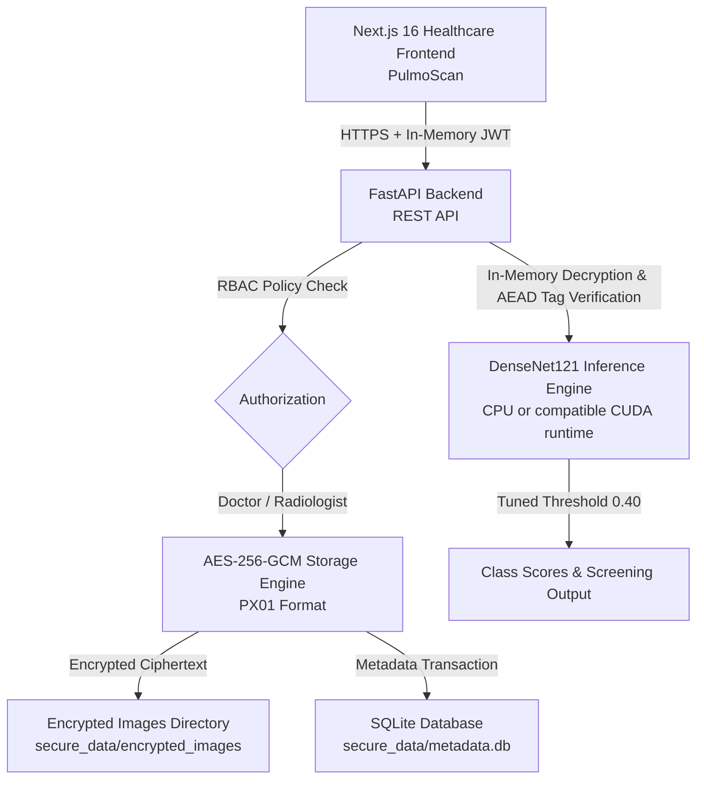

# AI-Based Pneumonia Detection with Secure Storage & Transmission of Medical Data

An educational healthcare software engineering project implementing end-to-end secure medical radiograph storage, deep learning diagnostic screening, and practitioner workflows.

**Patient workflow and current models:** see [patient management, file storage, and model inventory](docs/PATIENT_WORKFLOW_AND_STORAGE.md). The UI supports readable laptop text, expandable X-rays, patient follow-up/history, patient ID edits/deletion, and editable practitioner accounts. The repeated 93.75% entries were identical synthetic test uploads; those 10 scans and encrypted files have been cleared. Both latest Kaggle v2 model checkpoints are preserved locally; the original model remains the configured app default.

---

## System Requirements: Read Before Setup

These are practical baselines for running the frontend and backend locally with one-image screening. They are not certified hard minimums or multi-user server sizing guarantees.

| Component | CPU-only system | CPU + supported NVIDIA GPU |
|---|---|---|
| Processor | Modern 4-core Intel Core i5 / AMD Ryzen 5 class x86-64 CPU or better | Same; the CPU still handles the API, image decoding, and storage |
| System RAM | 8 GB baseline; 16 GB recommended with browser and development tools | 8 GB baseline; 16 GB recommended |
| Graphics | No dedicated GPU required; Intel/AMD integrated graphics are fine | At least 4 GB dedicated VRAM and a compatible NVIDIA driver; see GPU profiles below |
| Free SSD space | Plan for at least 20 GB for tools, dependencies, and caches | Plan for at least 30 GB for tools, CUDA wheels, and caches |
| Extra storage | Add space for uploaded images and any training dataset | Same |
| Supported installer platforms | Windows 10/11 64-bit or Linux x86-64 | Same |
| Software | Python **3.11**, Node.js **22+**, npm **10+** | Same; NVIDIA driver also required |

The existing **i5-11400H / GTX 1650 4 GB / 16 GB RAM** laptop meets this local-development baseline. A 512 GB SSD is sufficient in capacity; check free space rather than total capacity. The trained checkpoint is required for prediction; the training dataset is not.

### GPU compatibility and automatic CPU fallback

CUDA is NVIDIA technology. This setup accelerates compatible NVIDIA GPUs; AMD/Intel graphics use CPU. Apple Silicon/MPS, ROCm, Windows ARM, Jetson, and other ARM platforms are outside this installer's supported matrix. It does not claim support for every GPU ever released.

| Detected GPU family | Dependency profile | Conservative driver baseline: Windows / Linux |
|---|---|---|
| Turing, Ampere, Ada, Hopper: GTX 16, RTX 20/30/40 and matching workstation/datacenter GPUs; compute capability 7.5, 8.0, 8.6, 8.9, 9.0 | PyTorch `2.5.1+cu124`, torchvision `0.20.1+cu124` | `551.61+` / `550.54.14+` |
| Blackwell: RTX 50 and matching GPUs; compute capability 10.0 or 12.0 | PyTorch `2.7.1+cu128`, torchvision `0.22.1+cu128` | `570.65+` / `570.26+` |
| No NVIDIA GPU, older/unknown architecture, less than 4 GB VRAM, or insufficient driver | PyTorch `2.5.1+cpu`, torchvision `0.20.1+cpu` | No NVIDIA driver needed |

The setup helper checks actual GPU capability, VRAM, and driver rather than assuming any installed graphics card can run CUDA. These versioned profiles follow the [official PyTorch build matrix](https://pytorch.org/get-started/previous-versions/) and conservative toolkit-driver pairings from [NVIDIA CUDA 12.4](https://docs.nvidia.com/cuda/archive/12.4.0/cuda-toolkit-release-notes/index.html) and [CUDA 12.8](https://docs.nvidia.com/cuda/archive/12.8.0/cuda-toolkit-release-notes/index.html). Other GPU models in the same supported capability groups can qualify; successful execution is verified after installation. The Blackwell profile is provided for compatibility but has not been physically tested on this GTX 1650 laptop.

**Default behavior:** setup selects a matching CUDA build when a GPU qualifies; otherwise it selects CPU. If CUDA installation or its execution check fails, automatic setup attempts to restore CPU dependencies and reports the failure. At application startup, `PULMOSCAN_DEVICE=auto` tries a real GPU kernel and warms up the actual model; unavailable or unusable CUDA falls back to CPU with a warning. No packages or drivers are installed when starting the app. A runtime out-of-memory error during a later request is not silently retried on another device.

Leave `PULMOSCAN_DEVICE=auto` in `.env` for GPU preference with CPU fallback. Set it to `cpu` to force CPU, or `cuda` to require a GPU and fail clearly instead of falling back. Installing the standalone CUDA Toolkit is unnecessary for these prebuilt PyTorch wheels; a compatible NVIDIA driver is required. A CPU-only PyTorch installation cannot use a GPU until dependencies are changed.

On the GTX 1650 laptop, the CUDA 12.4 profile has been installed and the real checkpoint has completed offline predictions on both `cuda:0` and forced CPU. Other GPU profiles are covered by simulated selection tests; they have not all been physically tested. In containers or virtual machines, the GPU must also be exposed to that environment.

**Training is separate:** 16 GB system RAM is a starting point, with 32 GB more comfortable. The local profile uses batch 2 with accumulation 8 for a 4 GB GPU; larger physical batches are not guaranteed to fit. Around 8–12 GB VRAM gives more room. CPU training is supported but slower. Add dataset and checkpoint storage beyond the allowances above. Starting the web app never trains or modifies model weights.

---

## Architecture Overview



---

## Core Capabilities by Phase

1. **Phase 1: Cryptography & Secure Storage**
   - **AES-256-GCM authenticated encryption** with NIST SP 800-38D recommended 96-bit nonces.
   - SHA-256 integrity digest verification and HMAC-SHA256 transmission utilities.
   - Atomic disk writes (`.tmp` to `.enc` replace) preventing partial/truncated files.
   - SQLite metadata tracking with pseudonymous identifiers (`ANON-XXXXX`).

2. **Phase 2: FastAPI Backend & RBAC**
   - Signed JWT authentication (HMAC-SHA256, 30-minute expiration).
   - Salted Bcrypt password hashing (cost factor 12) with constant-time verification.
   - Strict role-based access control (Doctor ownership vs Radiologist institutional review).
   - In-memory DenseNet121 inference using CPU, or CUDA when a compatible GPU-enabled PyTorch installation is available.
   - Liveness (`/health`) and readiness (`/health/ready`) probes.

3. **Phase 3: Next.js Frontend ("PulmoScan")**
   - Modern App Router, React 19, TypeScript, and Tailwind CSS.
   - In-memory token management in React state (zero storage in `localStorage` or cookies).
   - Practitioner dashboard, drag-and-drop X-ray upload, real-time preview cleanup.
   - Repository browsing with search and status filtering.
   - Probability visualization and clinical decision support disclaimers.

4. **Phase 4: Security Hardening & End-to-End Validation**
   - Production configuration validation preventing insecure default keys.
   - Thread-safe sliding-window rate limiting on login (10 req/min) and inference (30 req/min).
   - Pillow decompression bomb safeguards (`MAX_IMAGE_PIXELS = 16.7M`).
   - OWASP security headers (CSP, HSTS, X-Frame-Options, X-Content-Type-Options).
   - Live end-to-end integration test suite and key recovery verification.

5. **Phase 5: Deployment, Release Preparation & Benchmarking**
   - Earlier project benchmark reports include CPU and CUDA inference measurements; these are not timing guarantees for other machines. See the [model and hardware guide](docs/MODEL_AND_HARDWARE.md) for the verified local setup and measurement scope.
   - Multi-stage Docker containerization and Docker Compose orchestration with persistent storage.
   - Graceful hardware fallback from CUDA to CPU.
   - Operational staging deployment guide, disaster recovery runbook, and release checklist.

---

## Project Documentation Index

- [Local Setup and Turborepo Commands](docs/LOCAL_SETUP.md)
- [How the Model Works, CPU/GPU Selection & Hardware Requirements](docs/MODEL_AND_HARDWARE.md)
- [Dataset Download, Folder Layout & Training Preparation](docs/DATASET_SETUP.md)
- [Backend Review and Measured Model Baseline](docs/BACKEND_REVIEW.md)
- [Manual Training, Preprocessing, Logs & Resume](docs/TRAINING.md)
- [Complete User Guide, Page Map & RBAC Guide](USER_GUIDE_AND_ACCESS_CONTROL.md)
- [Security Audit Report](docs/SECURITY_AUDIT.md)
- [End-to-End Testing Report](docs/END_TO_END_TESTING.md)
- [Deployment Preparation & Operations Guide](docs/DEPLOYMENT.md)
- [API Documentation](docs/API_DOCUMENTATION.md)
- [Secure Storage Cryptography Specification](docs/SECURE_STORAGE.md)
- [Frontend Documentation](frontend/README.md)
- [Frontend Appearance and UX Review](docs/FRONTEND_UX.md)

---

## Local Setup and Running the Application

Follow the [complete setup guide](docs/LOCAL_SETUP.md) for prerequisites, creating `.venv`, installing Python and Node dependencies, and generating local configuration. The same steps are included in [section 10 of the user guide](USER_GUIDE_AND_ACCESS_CONTROL.md#10-local-setup--execution-guide-windows-powershell).

From the project root, create an environment if needed, install dependencies for the detected hardware, and create local configuration:

```powershell
py -3.11 -m venv .venv
.\.venv\Scripts\python.exe -m pip install --upgrade pip
# Read-only preview of the selected CPU/CUDA dependency profile:
.\.venv\Scripts\python.exe scripts/setup_compute.py
# Apply that profile and install the shared backend dependencies:
.\.venv\Scripts\python.exe scripts/setup_compute.py --install
npm.cmd ci
npm.cmd ci --prefix frontend
.\.venv\Scripts\python.exe scripts/setup_local_env.py
npm.cmd run dev:check
# Optional offline checkpoint test; does not start an API or frontend:
.\.venv\Scripts\python.exe scripts/check_compute.py --model
```

If `.venv` already exists, skip creating it. Keep your existing `.env` so stored scans remain decryptable. Run `setup_compute.py --install` once to replace an existing CPU-only torch build with CUDA on a qualifying GPU, including the GTX 1650. The installer only modifies the project's `.venv`. Use `--device cpu --install` for CPU dependencies, or `--device cuda --install` for strict GPU setup. Installation never changes encryption keys, trains the model, or starts servers. Stop any manually running backend before replacing its native Python packages.

These commands use Windows PowerShell. On supported Linux x86-64 systems, create the environment with `python3.11 -m venv .venv`, use `.venv/bin/python` in place of `.venv\Scripts\python.exe`, and use `npm` in place of `npm.cmd`.

For later runs, dependency installation is unnecessary unless rebuilding or changing the environment. `scripts/check_compute.py` reports the installed torch build, packaged CUDA runtime, and actual selected device. The offline `--model` test uses a synthetic image to verify execution, not diagnostic accuracy.

### Where Python dependencies are installed

`setup_compute.py --install` performs **both** installations: the selected torch/torchvision profile, then **`pip install -r requirements.txt`** with the project's compatibility constraints. It prints that second step explicitly and finishes with `pip check`. Both stages are required for a fresh environment.

| File | Purpose |
|---|---|
| `requirements.txt` | Pinned shared dependencies used by the API, model preprocessing/training/evaluation, plots, and backend tests |
| `requirements/compute-cpu.txt` | Exact CPU-only torch/torchvision pair |
| `requirements/compute-cu124.txt` | Exact CUDA 12.4 pair, including the GTX 1650 profile |
| `requirements/compute-cu128.txt` | Exact CUDA 12.8 pair for the documented Blackwell profile |
| `constraints-local.txt` | Additional compatibility constraints for the shared backend stack |

Hardware-dependent torch packages are kept out of the shared file so reinstalling shared dependencies cannot replace a CUDA installation with a CPU build or select an unrelated torch version. Versions come from the working Python 3.11 setup; this is a direct-dependency pin set, not a complete transitive lockfile. No Kaggle SDK, OpenCV, TensorFlow, or other unused frameworks are required.

To reinstall **only shared dependencies** after selecting the compute profile:

```powershell
.\.venv\Scripts\python.exe -m pip install -r requirements.txt -c constraints-local.txt
.\.venv\Scripts\python.exe -m pip check
```

For a fresh environment, use `setup_compute.py --install` first; the shared file alone intentionally does not install torch. Equivalent manual GPU installation for your GTX 1650 is:

```powershell
.\.venv\Scripts\python.exe -m pip install -r requirements/compute-cu124.txt --index-url https://download.pytorch.org/whl/cu124
.\.venv\Scripts\python.exe -m pip install -r requirements.txt -c constraints-local.txt
.\.venv\Scripts\python.exe scripts/check_compute.py --model
```

Use `requirements/compute-cpu.txt` with the `/cpu` wheel index for a CPU-only installation. The automatic helper remains the recommended route because it checks eligibility and handles fallback.

Then start both services manually with one command:

```powershell
npm.cmd run dev
```

Turborepo checks setup once, then starts FastAPI and Next.js concurrently with labelled logs. Press **Ctrl+C** to stop both. The launcher uses this project's `.venv` directly; activating it is optional.

| Interface | URL |
|---|---|
| Staff login | http://localhost:3000/login/staff |
| Radiologist login | http://localhost:3000/login/radiologist |
| Backend readiness | http://127.0.0.1:8000/health/ready |
| API documentation | http://127.0.0.1:8000/docs |

Use `npm.cmd run dev:frontend` or `npm.cmd run dev:backend` to launch one service. `npm.cmd run dev:plan` shows Turbo's task plan without executing it.

### Automated Checks

Backend initialization, readiness, and test storage isolation are described in [backend operations](docs/BACKEND_OPERATIONS.md). Readiness reports the loaded checkpoint fingerprint and operational component status; it does not certify model quality. The default pytest suite uses private temporary storage and test-only keys rather than application storage.

```powershell
.\.venv\Scripts\python.exe -m pytest tests/test_dev_setup.py -v
npm.cmd --prefix frontend test
npm.cmd --prefix frontend run lint
```

The full backend suite remains available via `.\.venv\Scripts\python.exe -m pytest tests/ -v`. The live workflow check requires an already running backend: `.\.venv\Scripts\python.exe tests/e2e_live_verification.py`.

---

## Dataset for Training and Evaluation

This project uses **Kermany et al., Chest X-Ray Images (Pneumonia), from Kaggle**. Download the [Chest X-Ray Images (Pneumonia) dataset by Paul Mooney](https://www.kaggle.com/datasets/paultimothymooney/chest-xray-pneumonia), then extract the folder containing `train`, `val`, and `test` to `data/chest_xray/`. Each split should contain `NORMAL/` and `PNEUMONIA/`. The related [original Kermany dataset record](https://data.mendeley.com/datasets/rscbjbr9sj/2) includes both OCT and chest X-ray data; this project needs the chest X-rays.

The images are not included in this repository. Downloading them does not retrain the model. The app and automated backend tests can use the saved checkpoint without the training dataset. Check the [dataset setup guide](docs/DATASET_SETUP.md) for the exact folder tree, a read-only image check, split limitations, and what to obtain from your teammate to reproduce the previous experiment. The entire `data/` directory is ignored by Git.

The current local download is directly under `data/train`, `data/val`, and `data/test`; the audit tools accept it without moving images:

```powershell
.\.venv\Scripts\python.exe scripts/audit_dataset.py --data-dir data
.\.venv\Scripts\python.exe scripts/evaluate_backend.py --data-dir data
```

These commands do not start servers or train. They write ignored reports under `data/review/`. The [backend review](docs/BACKEND_REVIEW.md) records the historical findings and outstanding input-suitability, multipart-spooling, and dependency-security limitations. Old generated results and the local baseline prediction JSON have been removed. Dataset integrity audits and prepared manifests remain; new model training results are written only under `data/experiments/<timestamp>/`.

The historical review documents patient overlap and duplicate leakage concerns. Before new training, audit the splits rather than treating previous metrics or a random split as independently validated accuracy.

---

## Train Manually in Your Terminal

**Current laptop status:** another source-image checksum failure occurred during epoch 3. Its cause has not been diagnosed. Local training correctly stops on this failure; do not change hashes or silently skip images. The local runner remains available for a verified dataset on a reliable machine. To move this training to Kaggle, use the standalone notebook below.

The current prepared manifest contains **4,035 training / 712 validation / 618 test images**. It uses the existing source images without creating another dataset copy, excludes suspect and test-connected candidate groups, and deduplicates decoded pixels. Four unexpectedly changed source files and their connected groups were excluded; image hashes are checked during training. See the [training guide](docs/TRAINING.md) for the integrity findings and exact split policy.

Stop the backend first if it is running, then run from the project root:

```powershell
.\.venv\Scripts\python.exe -u scripts/train_models.py
```

This trains **DenseNet121, then EfficientNet-B0**, with live batch/epoch logs and separate saved artifacts under `data/experiments/<timestamp>/`. Defaults target the GTX 1650: 224px images, physical batch 2, gradient accumulation 8, mixed precision on CUDA, classifier warm-up, frozen batch-normalization statistics, and up to 25 epochs per candidate with early stopping. Preprocessing preserves aspect ratio with letterboxing and uses mild training-only augmentation.

Checkpoint/model selection and threshold tuning use validation data. Test evaluation is a separate explicit step after reviewing the candidates. The runner never replaces the app's checkpoint automatically; actual accuracy must be measured after training. [configs/train_local.json](configs/train_local.json) contains the active settings; `configs/train_config.json` records the older experiment format.

To check hashes and pretrained-model forward passes **without training**:

```powershell
.\.venv\Scripts\python.exe -u scripts/train_models.py --check
```

The [training guide](docs/TRAINING.md) includes log locations, resume commands, smaller-batch settings, final evaluation, and rebuilding preparation for a new dataset version. The pretrained forward checks have passed on the local GTX 1650. They do not establish full training memory use or predictive accuracy.

## Train on Kaggle

**Latest progress:** raw-logit diagnostics are verified, and an experimental temperature-only profile has been fitted from development calibration data. No further Kaggle training is needed for this step. See **[calibration and external-validation instructions](docs/CALIBRATION_AND_EXTERNAL_VALIDATION.md)** for the results, stable scoring changes, and the remaining need for a separate labelled cohort. The profile is not deployed.

**Completed diagnostic reference:** [kaggle/PulmoScan_Logit_Diagnostics.ipynb](kaggle/PulmoScan_Logit_Diagnostics.ipynb) and [the logit guide](docs/LOGIT_DIAGNOSTICS.md) reproduce the saved v2 analysis without retraining. They are retained for reproducibility; the results are already verified.

**v2 training reference:** [kaggle/PulmoScan_Training_v2.ipynb](kaggle/PulmoScan_Training_v2.ipynb) and [the v2 guide](docs/TRAINING_V2.md) describe the calibration holdout and JPEG-robustness experiment. Its completed results are reviewed in the guides above. The [original model review](docs/MODEL_REVIEW_2026-11-10.md) records the earlier validation/benchmark gap. The existing benchmark must not be relabelled as fresh after further experiments.

For the original v1 workflow:

Import **[kaggle/PulmoScan_Training.ipynb](kaggle/PulmoScan_Training.ipynb)** into a Kaggle notebook, attach the [Chest X-Ray Images (Pneumonia) dataset](https://www.kaggle.com/datasets/paultimothymooney/chest-xray-pneumonia), select an available GPU, and enable Internet. The notebook embeds the shared training code, so no project ZIP, local dataset, `.env`, or repository credentials are needed. It audits Kaggle's input directly, trains both candidates, displays validation results, and creates a model ZIP with checksums. Final test evaluation is an explicit optional step after validation review.

Follow **[kaggle/README.md](kaggle/README.md)** for exact setup, settings, resume, saving notebook outputs, and downloading/importing the trained candidates. Local GPU/CPU training stays available with its smaller-batch profile. Importing downloaded results never replaces the live app model automatically.

---

## Clinical Disclaimer

This software is an educational prototype developed for academic demonstration. It is **not** an FDA-cleared diagnostic device and should never replace qualified clinical radiological interpretation.
