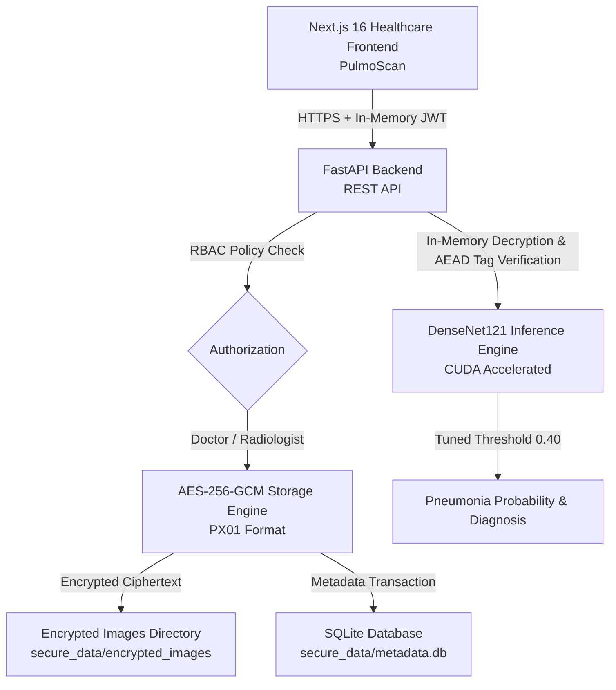

# AI-Based Pneumonia Detection with Secure Storage & Transmission of Medical Data

An educational healthcare software engineering project implementing end-to-end secure medical radiograph storage, deep learning diagnostic screening, and practitioner workflows.

---

## Architecture Overview



---

## Core Capabilities by Phase

1. **Phase 1: Cryptography & Secure Storage**
   - **AES-256-GCM authenticated encryption** with NIST SP 800-38D recommended 96-bit nonces.
   - SHA-256 integrity digest verification and HMAC-SHA256 transmission utilities.
   - Atomic disk writes (`.tmp` to `.enc` replace) preventing partial/truncated files.
   - SQLite metadata tracking with pseudonymous identifiers (`ANON-XXXXX`).

2. **Phase 2: FastAPI Backend & RBAC**
   - Signed JWT authentication (HMAC-SHA256, 30-minute expiration).
   - Salted Bcrypt password hashing (cost factor 12) with constant-time verification.
   - Strict role-based access control (Doctor ownership vs Radiologist institutional review).
   - In-memory DenseNet121 inference on NVIDIA RTX 3050 Laptop GPU (`cuda`).
   - Liveness (`/health`) and readiness (`/health/ready`) probes.

3. **Phase 3: Next.js Frontend ("PulmoScan")**
   - Modern App Router, React 19, TypeScript, and Tailwind CSS.
   - In-memory token management in React state (zero storage in `localStorage` or cookies).
   - Practitioner dashboard, drag-and-drop X-ray upload, real-time preview cleanup.
   - Repository browsing with search and status filtering.
   - Probability visualization and clinical decision support disclaimers.

4. **Phase 4: Security Hardening & End-to-End Validation**
   - Production configuration validation preventing insecure default keys.
   - Thread-safe sliding-window rate limiting on login (10 req/min) and inference (30 req/min).
   - Pillow decompression bomb safeguards (`MAX_IMAGE_PIXELS = 16.7M`).
   - OWASP security headers (CSP, HSTS, X-Frame-Options, X-Content-Type-Options).
   - Live end-to-end integration test suite and key recovery verification.

---

## Project Documentation Index

- [Security Audit Report](file:///c:/Users/VIVEK/Desktop/ISC%20Project/docs/SECURITY_AUDIT.md)
- [End-to-End Testing Report](file:///c:/Users/VIVEK/Desktop/ISC%20Project/docs/END_TO_END_TESTING.md)
- [Deployment Preparation & Operations Guide](file:///c:/Users/VIVEK/Desktop/ISC%20Project/docs/DEPLOYMENT.md)
- [API Documentation](file:///c:/Users/VIVEK/Desktop/ISC%20Project/docs/API_DOCUMENTATION.md)
- [Secure Storage Cryptography Specification](file:///c:/Users/VIVEK/Desktop/ISC%20Project/docs/SECURE_STORAGE.md)
- [Frontend Documentation](file:///c:/Users/VIVEK/Desktop/ISC%20Project/frontend/README.md)

---

## Running the Application

### 1. Run the Backend API
```powershell
# From project root
.\.venv\Scripts\python.exe -m uvicorn src.api.main:app --host 127.0.0.1 --port 8000
```
Interactive API docs: `http://127.0.0.1:8000/docs`

### 2. Run the Next.js Frontend
```powershell
# From frontend/ directory
cd frontend
npm run dev
```
Open `http://localhost:3000` in browser.

### 3. Run Test Suites
```powershell
# Run backend pytest suite (44 tests)
.\.venv\Scripts\python.exe -m pytest tests/ -v

# Run live end-to-end verification (requires backend running)
.\.venv\Scripts\python.exe tests/e2e_live_verification.py

# Run frontend test suite (26 tests)
cd frontend
npm run test
```

---

## Clinical Disclaimer

This software is an educational prototype developed for academic demonstration. It is **not** an FDA-cleared diagnostic device and should never replace qualified clinical radiological interpretation.
