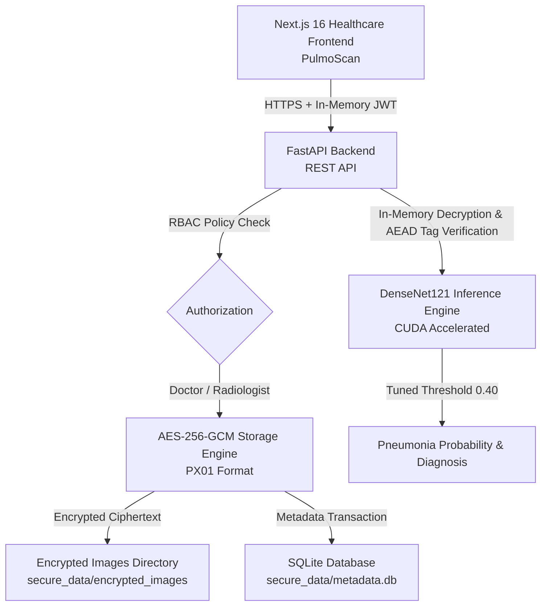

# AI-Based Pneumonia Detection with Secure Storage & Transmission of Medical Data

An educational healthcare software engineering project implementing end-to-end secure medical radiograph storage, deep learning diagnostic screening, and practitioner workflows.

---

## Architecture Overview



---

## Core Capabilities by Phase

1. **Phase 1: Cryptography & Secure Storage**
   - **AES-256-GCM authenticated encryption** with NIST SP 800-38D recommended 96-bit nonces.
   - SHA-256 integrity digest verification and HMAC-SHA256 transmission utilities.
   - Atomic disk writes (`.tmp` to `.enc` replace) preventing partial/truncated files.
   - SQLite metadata tracking with pseudonymous identifiers (`ANON-XXXXX`).

2. **Phase 2: FastAPI Backend & RBAC**
   - Signed JWT authentication (HMAC-SHA256, 30-minute expiration).
   - Salted Bcrypt password hashing (cost factor 12) with constant-time verification.
   - Strict role-based access control (Doctor ownership vs Radiologist institutional review).
   - In-memory DenseNet121 inference on NVIDIA RTX 3050 Laptop GPU (`cuda`).
   - Liveness (`/health`) and readiness (`/health/ready`) probes.

3. **Phase 3: Next.js Frontend ("PulmoScan")**
   - Modern App Router, React 19, TypeScript, and Tailwind CSS.
   - In-memory token management in React state (zero storage in `localStorage` or cookies).
   - Practitioner dashboard, drag-and-drop X-ray upload, real-time preview cleanup.
   - Repository browsing with search and status filtering.
   - Probability visualization and clinical decision support disclaimers.

4. **Phase 4: Security Hardening & End-to-End Validation**
   - Production configuration validation preventing insecure default keys.
   - Thread-safe sliding-window rate limiting on login (10 req/min) and inference (30 req/min).
   - Pillow decompression bomb safeguards (`MAX_IMAGE_PIXELS = 16.7M`).
   - OWASP security headers (CSP, HSTS, X-Frame-Options, X-Content-Type-Options).
   - Live end-to-end integration test suite and key recovery verification.

5. **Phase 5: Deployment, Release Preparation & Benchmarking**
   - Empirical CPU and CUDA GPU inference benchmarking (CPU: ~34 ms, CUDA: ~22 ms).
   - Multi-stage Docker containerization and Docker Compose orchestration with persistent storage.
   - Graceful hardware fallback from CUDA to CPU.
   - Operational staging deployment guide, disaster recovery runbook, and release checklist.

---

## Project Documentation Index

- [Local Setup and Turborepo Commands](docs/LOCAL_SETUP.md)
- [Complete User Guide, Page Map & RBAC Guide](USER_GUIDE_AND_ACCESS_CONTROL.md)
- [Security Audit Report](docs/SECURITY_AUDIT.md)
- [End-to-End Testing Report](docs/END_TO_END_TESTING.md)
- [Deployment Preparation & Operations Guide](docs/DEPLOYMENT.md)
- [API Documentation](docs/API_DOCUMENTATION.md)
- [Secure Storage Cryptography Specification](docs/SECURE_STORAGE.md)
- [Frontend Documentation](frontend/README.md)
- [Frontend Appearance and UX Review](docs/FRONTEND_UX.md)

---

## Local Setup and Running the Application

Follow the [complete setup guide](docs/LOCAL_SETUP.md) for prerequisites, creating `.venv`, installing Python and Node dependencies, and generating local configuration. The same steps are included in [section 10 of the user guide](USER_GUIDE_AND_ACCESS_CONTROL.md#10-local-setup--execution-guide-windows-powershell).

If the existing Python environment already runs the app, keep it. From the project root, install the new Turborepo dependency and check setup:

```powershell
npm.cmd ci
npm.cmd ci --prefix frontend
.\.venv\Scripts\python.exe scripts/setup_local_env.py
npm.cmd run dev:check
```

Then start both services manually with one command:

```powershell
npm.cmd run dev
```

Turborepo checks setup once, then starts FastAPI and Next.js concurrently with labelled logs. Press **Ctrl+C** to stop both. The launcher uses this project's `.venv` directly; activating it is optional.

| Interface | URL |
|---|---|
| Staff login | http://localhost:3000/login/staff |
| Radiologist login | http://localhost:3000/login/radiologist |
| Backend readiness | http://127.0.0.1:8000/health/ready |
| API documentation | http://127.0.0.1:8000/docs |

Use `npm.cmd run dev:frontend` or `npm.cmd run dev:backend` to launch one service. `npm.cmd run dev:plan` shows Turbo's task plan without executing it.

### Automated Checks

```powershell
.\.venv\Scripts\python.exe -m pytest tests/test_dev_setup.py -v
npm.cmd --prefix frontend test
npm.cmd --prefix frontend run lint
```

The full backend suite remains available via `.\.venv\Scripts\python.exe -m pytest tests/ -v`. The live workflow check requires an already running backend: `.\.venv\Scripts\python.exe tests/e2e_live_verification.py`.

---

## Clinical Disclaimer

This software is an educational prototype developed for academic demonstration. It is **not** an FDA-cleared diagnostic device and should never replace qualified clinical radiological interpretation.
