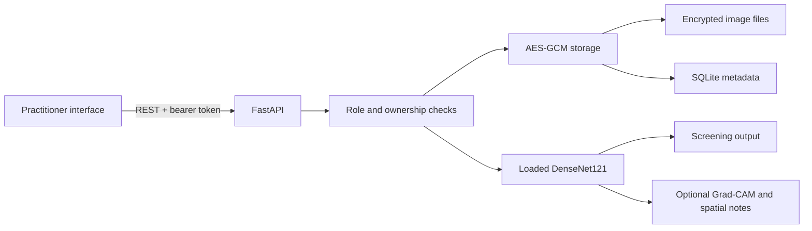

# PulmoScan: Secure Chest X-Ray Screening

PulmoScan is an academic prototype combining **pneumonia image classification, encrypted radiograph storage and practitioner access control**. Authorized users upload an X-ray, run a saved DenseNet121 classifier and optionally inspect a Grad-CAM overlay with linked image-region notes.

The project addresses protected storage and reviewable disease-screening workflows. It is not a clinically validated diagnostic device. Model scores are uncalibrated, and contribution maps do not establish medical findings or confirmed pneumonia locations.

## Features and architecture

- Staff/doctor access to their own uploads; radiologists/admins can review all scans.
- AES-256-GCM encrypted image files with integrity checks and SQLite metadata.
- Patient grouping, follow-up history, patient-ID changes/deletion and editable practitioner accounts. Patients have no login accounts.
- CPU or supported NVIDIA CUDA inference, model fingerprints and health/readiness probes.
- Original/Heatmap switching, linked numbered notes, enlarged images, zoom and light/dark appearance.
- Separate, reproducible training/evaluation workflows; uploads never train the model.



| Component | Implementation |
| --- | --- |
| Backend | Python 3.11, FastAPI, Starlette, Pydantic, Uvicorn |
| Model | PyTorch/torchvision, DenseNet121, Pillow/NumPy preprocessing |
| Security | `cryptography` AES-GCM, SHA-256, PyJWT HS256, bcrypt |
| Storage | Encrypted files plus SQLite scan/account metadata |
| Frontend | Next.js 16.4.3, React 19.3.0, TypeScript, Tailwind CSS |
| Development/testing | Turborepo, Pytest, Vitest, React Testing Library |

## System Requirements: Read Before Setup

Practical baselines for local development and single-image inference, not certified minimums or multi-user capacity guarantees:

| Requirement | CPU only | CPU + supported NVIDIA GPU |
| --- | --- | --- |
| Platform | Windows 10/11 or Linux, x86-64 | Same |
| CPU | Modern 4-core Core i5 / Ryzen 5 class or better | Same; decoding, encryption, API and SQLite remain CPU-side |
| RAM | 8 GB baseline; 16 GB recommended | 8 GB baseline; 16 GB recommended |
| Graphics | Dedicated GPU not required | At least 4 GB VRAM and compatible architecture/driver |
| Free SSD space | Plan for 20 GB for tools, dependencies and caches | Plan for 30 GB; CUDA wheels are multi-gigabyte downloads |
| Python | **3.11** | **3.11** |
| Node.js | **22.13+ within 22.x, 24.x, or 26+** | Same |
| npm | **10+** | Same |

Add space for uploads, datasets and experiment artifacts. The saved model is needed; the training dataset is optional. Node 22.0?22.12 and odd releases 23/25 do not satisfy the locked frontend tooling requirements. The root and frontend package manifests declare the supported range.

### GPU compatibility and automatic CPU fallback

| Hardware | PyTorch / torchvision profile | Conservative driver baseline: Windows / Linux |
| --- | --- | --- |
| Turing?Hopper; capabilities 7.5, 8.0, 8.6, 8.9, 9.0 | `2.14.1+cu126` / `0.29.1+cu126` | `560.76+` / `560.28.03+` |
| Blackwell; capabilities 10.0, 12.0 | `2.14.1+cu130` / `0.29.1+cu130` | `580.88+` / `580.65.06+` |
| No qualifying NVIDIA GPU/driver | `2.14.1+cpu` / `0.29.1+cpu` | Not required |

The installer inspects capability, VRAM and driver and verifies execution. These pairs follow the [PyTorch version matrix](https://pytorch.org/get-started/previous-versions/), [CUDA 12.6 notes](https://docs.nvidia.com/cuda/archive/12.6.0/cuda-toolkit-release-notes/index.html) and [NVIDIA R580 notes](https://docs.nvidia.com/datacenter/tesla/tesla-release-notes-580-65-06/index.html). They do not promise support for every GPU. The reviewed CUDA 12.6 path has physical test evidence; other profiles also have simulated selection checks.

`PULMOSCAN_DEVICE=auto` prefers working CUDA and falls back to CPU during initialization. `cpu` forces CPU; `cuda` requires CUDA. Later out-of-memory errors are not silently retried on CPU. CUDA wheels need a compatible driver, not a separately installed CUDA Toolkit. AMD/Intel graphics use CPU; MPS, ROCm, ARM and Jetson are outside this installer's documented matrix.

## Local Setup and Running the Application

Clone or download this repository, then open a terminal in its root directory: the folder containing this README, `package.json`, `requirements.txt`, `src/` and `frontend/`. No personal directory paths or particular GPU model are required.

### Windows PowerShell

```powershell
# Create once; skip this line if this project's .venv already exists.
py -3.11 -m venv .venv
.\.venv\Scripts\python.exe -m pip install --upgrade pip

# Optional read-only preview, then install the selected compute pair and requirements.txt.
.\.venv\Scripts\python.exe scripts/setup_compute.py
.\.venv\Scripts\python.exe scripts/setup_compute.py --install

npm.cmd ci
npm.cmd ci --prefix frontend
.\.venv\Scripts\python.exe scripts/setup_local_env.py
npm.cmd run dev:check
```

### Linux / WSL x86-64

```bash
python3.11 -m venv .venv
.venv/bin/python -m pip install --upgrade pip
.venv/bin/python scripts/setup_compute.py
.venv/bin/python scripts/setup_compute.py --install
npm ci
npm ci --prefix frontend
.venv/bin/python scripts/setup_local_env.py
npm run dev:check
```

These commands use the project interpreter directly, so activation is optional. If the Python executable is unavailable, install Python 3.11 first. The setup helper refuses to install compute packages into global Python. For CPU-only installation, use `--device cpu --install`; strict GPU installation uses `--device cuda --install`. Stop a running backend before replacing its native packages.

`setup_local_env.py` creates missing `.env` and `frontend/.env.local` files and preserves existing files. Keep the existing encryption key when retaining stored scans. The default frontend API URL is `http://127.0.0.1:8000`. Configuration creation, installation and preflight do not start servers or train models.

### Where Python dependencies are installed

`setup_compute.py --install` installs **both** the hardware-specific torch/torchvision pair and the shared **`requirements.txt`**, with compatibility constraints, then checks the installation.

| File | Purpose |
| --- | --- |
| `requirements.txt` | Shared direct Python dependencies |
| `requirements/compute-cpu.txt` | Exact CPU-only pair |
| `requirements/compute-cu126.txt` | Exact supported CUDA 12.6 pair |
| `requirements/compute-cu130.txt` | Exact supported CUDA 13.0 pair |
| `constraints-local.txt` | Shared compatibility constraints |

The shared file alone is not a complete fresh installation. For manual profile installation and later dependency maintenance, see [the complete setup guide](docs/LOCAL_SETUP.md). Root and frontend npm dependencies have separate lockfiles; install both with `npm ci`.

### Start manually

```powershell
# Windows PowerShell, from the project root
npm.cmd run dev
```

```bash
# Linux / WSL, from the project root
npm run dev
```

Turborepo checks setup and starts both services with labelled logs. Ctrl+C stops both. On later runs, use this startup command without reinstalling dependencies or recreating configuration.

| Interface | URL |
| --- | --- |
| Staff/doctor/admin login | http://localhost:3000/login/staff |
| Radiologist login | http://localhost:3000/login/radiologist |
| API docs | http://127.0.0.1:8000/docs |
| Liveness / readiness | http://127.0.0.1:8000/health ? http://127.0.0.1:8000/health/ready |

`dev:frontend` and `dev:backend` start services separately; run `dev:check` first. `dev:plan` prints Turbo's plan without starting services. Use `npm.cmd` on PowerShell, or `npm` on Linux. API docs use BearerAuth: call JSON `POST /auth/login`, then paste its access token into **Authorize**.

Demo users are created only in an empty users table when `SEED_DEMO_USERS` is enabled:

| Portal | Initial username | Public demonstration password |
| --- | --- | --- |
| Staff | `doctor1` | `DoctorPassword123!` |
| Radiologist | `radiologist1` | `RadioPassword123!` |

These are local demo accounts, not production secrets. Renamed accounts are not recreated on restart. The app does not persist credentials/tokens in browser storage; refresh/tab closure ends the in-memory session. Portal and appearance preferences may persist.

## Current model and measured results

| Artifact | Role |
| --- | --- |
| `models/densenet121_pneumonia_best.pth` | Bundled default DenseNet121: epoch 5, 224px stretch preprocessing, cutoff **0.40** |
| Kaggle v2 DenseNet121 | Optional imported candidate: epoch 20, letterbox preprocessing, saved cutoff approximately **0.9999873** |
| Kaggle v2 EfficientNet-B0 | Optional imported candidate: epoch 16; requires serving support before use by the DenseNet-specific API |

The default checkpoint SHA-256 is `5419fadee007300222c7f85e03bd2cb940fb2742864de5fe0b2be83c80bacd1f`. If it is missing, restore a trusted project artifact before startup; renaming another file is not a compatible replacement. Check Profile ? Active model, fresh prediction metadata or readiness for the actual loaded identity. Restart after deliberate checkpoint/configuration changes. Each checkpoint needs its own preprocessing/cutoff.

Imported candidates live under ignored `data/experiments/` and do not accompany a code-only clone. They are not automatically promoted. Keep their bundles separately. See [the model inventory](docs/PATIENT_WORKFLOW_AND_STORAGE.md).

The **Kaggle v2 DenseNet candidate**, not the default model, reported **86.57% accuracy** on a previously reviewed 618-image benchmark: TN=150, FP=81, FN=2, TP=385. Raw-margin ROC-AUC was **0.97321**; probability ROC-AUC was **0.83648** under saturation. This is historical dataset-specific evidence, not independent clinical validation. The experimental temperature profile is not loaded by the API. [Detailed assessment](docs/CALIBRATION_AND_EXTERNAL_VALIDATION.md).

## Explanation and storage boundaries

After fresh screening, **Explain prediction** generates an aligned Grad-CAM map and deterministic spatial notes. No external LLM, extra dataset or retraining is needed. It does not identify lung lobes, medical findings, severity or confirmed pneumonia locations. [Explanation guide](docs/EXPLAINABILITY.md).

Uploaded images are stored as encrypted copies in `secure_data/encrypted_images/`; the original selected file is unchanged. SQLite metadata is stored in `secure_data/metadata.db` and is **not itself encrypted**. Uploads do not populate the training dataset. Multipart ingestion can temporarily spool plaintext before encryption.

Local development uses **HTTP on loopback**. Remote deployment needs verified HTTPS/TLS, appropriate key/backup/audit controls and operational testing. Token signatures, AES storage, CORS and an HSTS header do not establish encrypted network transport. The project is not a regulatory/compliance certification.

## Dataset for Training and Evaluation

The optional classification data is [Chest X-Ray Images (Pneumonia) on Kaggle](https://www.kaggle.com/datasets/paultimothymooney/chest-xray-pneumonia): NORMAL/PNEUMONIA image labels, not finding boxes or reports. See [dataset setup](docs/DATASET_SETUP.md) for layouts and source/split checks. No dataset download is needed for the saved-model app.

## Optional Local Training

Training is a separate manual workflow described in [the training guide](docs/TRAINING.md). It writes isolated experiments and does not replace the live model. Use verified source images, the intended configuration and a fresh output location; do not bypass manifest/hash failures. Local batch/memory defaults are conservative research settings, not guarantees that every device can train the backbones.

## Train on Kaggle

The [Kaggle README](kaggle/README.md) explains the self-contained v1/v2 training and inference-only diagnostic notebooks. Completed experiments remain references; normal app use requires no Kaggle account or new run. The reserved benchmark was already reviewed and cannot be relabelled as fresh after further tuning.

Finding detection, medical report generation and the restricted finding dataset are deferred. Kafka, Redis, Prometheus, Grafana and Docker deployment are not implemented in this checkout.

### Automated Checks

GitHub Actions runs the backend tests on CPU and the frontend tests, lint, production build and Turborepo dry run on every push and pull request. No secrets, dataset or GPU are required. See [the CI guide](docs/CI.md) for workflow details, logs and optional merge protection.

After setup, from the project root:

```powershell
# Windows PowerShell
.\.venv\Scripts\python.exe -m pytest -q
npm.cmd --prefix frontend test
npm.cmd --prefix frontend run lint
npm.cmd --prefix frontend run build
npm.cmd run dev:check
```

```bash
# Linux / WSL
.venv/bin/python -m pytest -q
npm --prefix frontend test
npm --prefix frontend run lint
npm --prefix frontend run build
npm run dev:check
```

Tests use isolated temporary storage. Preflight does not initialize the application database or start services. A separate offline `scripts/check_compute.py --model` command checks the checkpoint using a synthetic image, not medical accuracy. Live end-to-end checks require services you started yourself.

The dated [application review](docs/FINAL_REVIEW_2026-11-13.md) records 232 backend / 106 frontend tests, eight CPU/CUDA checks and their exact scope. [Finalization notes](docs/FINALIZATION_2026-11-16.md) record the latest verification and generalized setup work. Passing software tests does not prove a clinically reliable model or exhaustively rule out bugs.

## Project Documentation Index

| Guide | Contents |
| --- | --- |
| [Local setup](docs/LOCAL_SETUP.md) | Fresh installation, both operating systems, dependencies, configuration, troubleshooting |
| [Continuous integration](docs/CI.md) | GitHub Actions checks, local reproduction and optional required checks |
| [Patient/storage/model guide](docs/PATIENT_WORKFLOW_AND_STORAGE.md) | Permissions, follow-up records, file storage and artifact inventory |
| [Explainability](docs/EXPLAINABILITY.md) | Grad-CAM, spatial notes, geometry, tests and limitations |
| [Training](docs/TRAINING.md) / [v2 protocol](docs/TRAINING_V2.md) | Auditing, splitting, fitting, checkpoints and evaluation |
| [Scoring/calibration](docs/CALIBRATION_AND_EXTERNAL_VALIDATION.md) | Saturation, candidate metrics and experimental postprocessing |
| [Handoff](docs/PROJECT_HANDOFF.md) | Manual review and scope boundaries |
| [Frontend](frontend/README.md) / [Kaggle](kaggle/README.md) / [Results](results/README.md) | Component-specific workflows |

Older reports and the [extended user guide](USER_GUIDE_AND_ACCESS_CONTROL.md) preserve historical sections. Use current setup instructions, dated follow-ups and source when they differ. No original training GPU model or universal performance guarantee is inferred from a saved `cuda:0` tensor tag.
