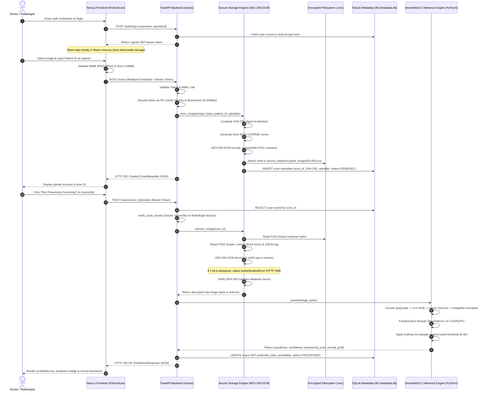
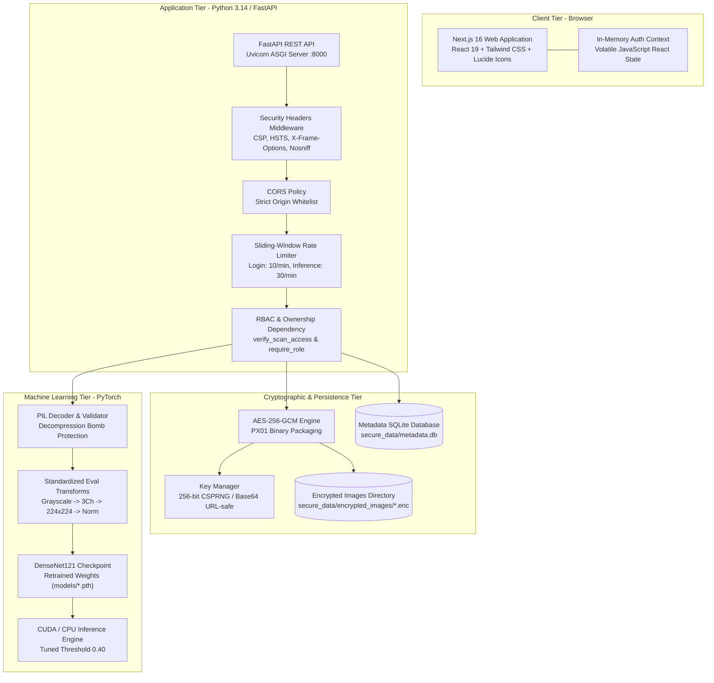
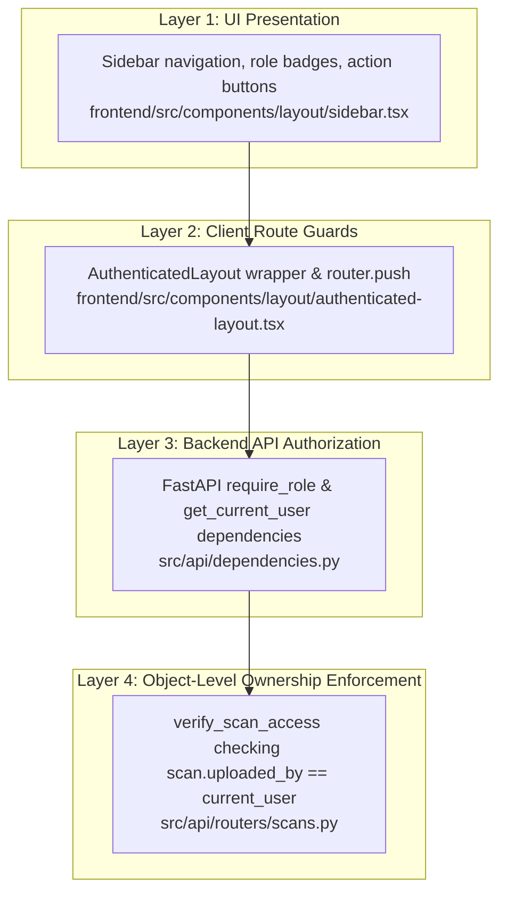
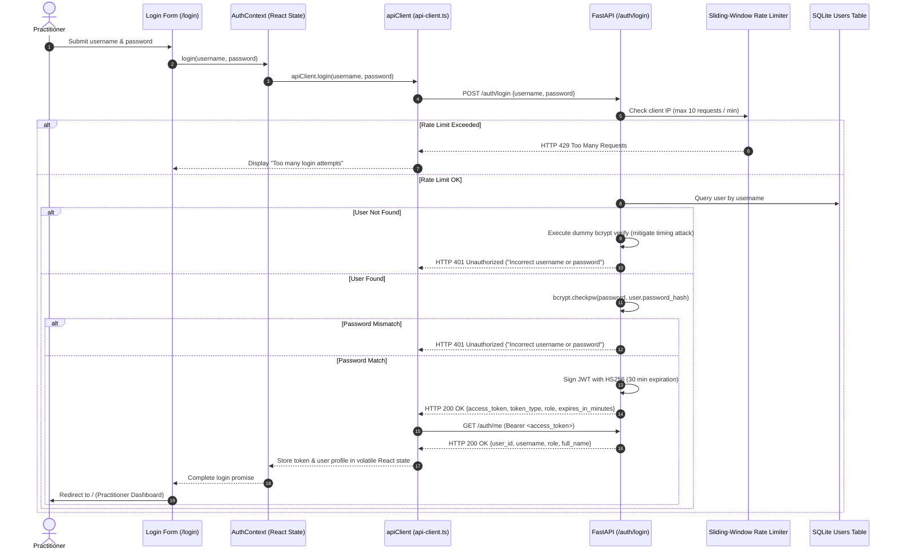

# PulmoScan: Complete User Guide, Page Map, Routing & Access Control Documentation

> **Clinical Prototype Notice:** PulmoScan is an educational and academic demonstration system developed to explore secure healthcare architecture, authenticated medical data storage, and deep learning-assisted screening. It is **not** an FDA-cleared, CE-marked, or clinically validated diagnostic medical device. Model outputs represent algorithmic screening scores and must **never** replace certified clinical radiological evaluation or physician judgment.

---

## Table of Contents

- [Quick Start Guide](#quick-start-guide)
- [Glossary of Essential Terms](#glossary-of-essential-terms)
- [1. Application Overview](#1-application-overview)
  - [1.1 Purpose & Target Users](#11-purpose--target-users)
  - [1.2 End-to-End Radiograph Lifecycle](#12-end-to-end-radiograph-lifecycle)
  - [1.3 System Component Architecture](#13-system-component-architecture)
  - [1.4 Operational Non-Goals & Boundaries](#14-operational-non-goals--boundaries)
- [2. Complete Frontend Page & Route Inventory](#2-complete-frontend-page--route-inventory)
- [3. Next.js Routing Architecture Explained](#3-nextjs-routing-architecture-explained)
  - [3.1 App Router Fundamentals](#31-app-router-fundamentals)
  - [3.2 File Roles: `page.tsx`, `layout.tsx`, and Route Segments](#32-file-roles-pagetsx-layouttsx-and-route-segments)
  - [3.3 Dynamic Route Resolution (`[id]`) in Next.js 16](#33-dynamic-route-resolution-id-in-nextjs-16)
  - [3.4 Client-Side Navigation vs Direct URL Loading](#34-client-side-navigation-vs-direct-url-loading)
  - [3.5 Frontend Route Guards vs Backend API Enforcement](#35-frontend-route-guards-vs-backend-api-enforcement)
  - [3.6 Frontend Page Routes vs FastAPI REST Endpoints](#36-frontend-page-routes-vs-fastapi-rest-endpoints)
- [4. Role-Based Access Control (RBAC)](#4-role-based-access-control-rbac)
  - [4.1 Verified Roles & Responsibilities](#41-verified-roles--responsibilities)
  - [4.2 Comprehensive Permissions Matrix](#42-comprehensive-permissions-matrix)
  - [4.3 Four-Layer Defense-in-Depth Architecture](#43-four-layer-defense-in-depth-architecture)
  - [4.4 UI Navigation Visibility vs Backend Authorization Enforcement](#44-ui-navigation-visibility-vs-backend-authorization-enforcement)
- [5. Authentication and Session Lifecycle](#5-authentication-and-session-lifecycle)
  - [5.1 Complete Authentication Flow](#51-complete-authentication-flow)
  - [5.2 JWT Architecture & Expiration](#52-jwt-architecture--expiration)
  - [5.3 Password Security & Timing Attack Mitigation](#53-password-security--timing-attack-mitigation)
  - [5.4 In-Memory Token Management (Zero Persistence Design)](#54-in-memory-token-management-zero-persistence-design)
  - [5.5 Session Refresh & Expiration Behavior](#55-session-refresh--expiration-behavior)
- [6. End-to-End User Workflows](#6-end-to-end-user-workflows)
  - [Workflow A: Staff Authentication & Logout](#workflow-a-staff-authentication--logout)
  - [Workflow B: Uploading & Encrypting a Radiograph](#workflow-b-uploading--encrypting-a-radiograph)
  - [Workflow C: Running AI Pneumonia Screening](#workflow-c-running-ai-pneumonia-screening)
  - [Workflow D: Browsing & Filtering Scan History](#workflow-d-browsing--filtering-scan-history)
  - [Workflow E: Inspecting Scan Details & Cryptographic Provenance](#workflow-e-inspecting-scan-details--cryptographic-provenance)
  - [Workflow F: Viewing Staff Profile & Credentials](#workflow-f-viewing-staff-profile--credentials)
  - [Workflow G: System Error Handling & Resilience](#workflow-g-system-error-handling--resilience)
- [7. Backend API Reference](#7-backend-api-reference)
  - [7.1 Health & Readiness Probes](#71-health--readiness-probes)
  - [7.2 Authentication Endpoints](#72-authentication-endpoints)
  - [7.3 Medical Scan & Inference Endpoints](#73-medical-scan--inference-endpoints)
- [8. Secure Image Storage and Cryptography](#8-secure-image-storage-and-cryptography)
  - [8.1 AES-256-GCM Container Format (`PX01`)](#81-aes-256-gcm-container-format-px01)
  - [8.2 CSPRNG Nonce Generation & Nonce-Reuse Mitigation](#82-csprng-nonce-generation--nonce-reuse-mitigation)
  - [8.3 In-Memory Decryption & Tamper Rejection](#83-in-memory-decryption--tamper-rejection)
  - [8.4 Metadata Pseudonymization vs Plaintext Storage Separation](#84-metadata-pseudonymization-vs-plaintext-storage-separation)
  - [8.5 Cryptographic Key Lifecycle & Recovery](#85-cryptographic-key-lifecycle--recovery)
- [9. AI Prediction Pipeline & DenseNet121 Deep Learning Model](#9-ai-prediction-pipeline--densenet121-deep-learning-model)
  - [9.1 Deep Learning Architecture](#91-deep-learning-architecture)
  - [9.2 In-Memory Image Preprocessing & Normalization](#92-in-memory-image-preprocessing--normalization)
  - [9.3 Optimized Decision Threshold (0.40) & Confidence Metrics](#93-optimized-decision-threshold-040--confidence-metrics)
  - [9.4 Clinical Screening vs Definitive Diagnosis](#94-clinical-screening-vs-definitive-diagnosis)
  - [9.5 Known Model Limitations](#95-known-model-limitations)
- [10. Local Setup & Execution Guide (Windows PowerShell)](#10-local-setup--execution-guide-windows-powershell)
  - [10.1 Environment Prerequisites](#101-environment-prerequisites)
  - [10.2 Step-by-Step Installation & Configuration](#102-step-by-step-installation--configuration)
  - [10.3 Launching the Local Services](#103-launching-the-local-services)
  - [10.4 Verifying Service Health & Interactive Docs](#104-verifying-service-health--interactive-docs)
  - [10.5 Running Automated Test Suites](#105-running-automated-test-suites)
  - [10.6 Graceful Shutdown](#106-graceful-shutdown)
- [11. Comprehensive Troubleshooting Guide](#11-comprehensive-troubleshooting-guide)
- [12. Known Limitations & Security Boundaries](#12-known-limitations--security-boundaries)
- [13. Related Documentation Links](#13-related-documentation-links)

---

## Quick Start Guide

For developers and evaluators who want to run the project locally right away:

### 1. Pre-configured Demo Accounts

When started in development mode (`APP_ENV=development`), the backend database seeds the following practitioner accounts:

| Role | Username | Password | Intended Role Profile |
|---|---|---|---|
| **Doctor** | `doctor1` | `DoctorPassword123!` | Dr. Sarah Chen, MD (Pediatrics) — Can upload and view own patients |
| **Radiologist** | `radiologist1` | `RadioPassword123!` | Dr. James Wilson, MD (Radiology) — Institutional review clearance |

> [!NOTE]
> Demo accounts are automatically seeded only in development/testing mode (`SEED_DEMO_USERS=true`). In production mode, seed routines are bypassed and strong environment keys are strictly enforced.

### 2. Local Service URLs

| Interface | Local URL | Description |
|---|---|---|
| **Frontend Web App** | `http://localhost:3000` | PulmoScan Next.js healthcare user interface |
| **Backend API Root** | `http://127.0.0.1:8000` | FastAPI application server |
| **Interactive API Docs** | `http://127.0.0.1:8000/docs` | Swagger UI with interactive endpoint testing |
| **Alternative API Docs** | `http://127.0.0.1:8000/redoc` | OpenAPI ReDoc specification |
| **Liveness Health Probe** | `http://127.0.0.1:8000/health` | HTTP probe checking backend process health |
| **Readiness Health Probe**| `http://127.0.0.1:8000/health/ready`| Deep check: Database, Storage, and Model status |

### 3. Quick Launch Commands (Windows PowerShell)

```powershell
# Terminal 1: Launch FastAPI Backend
cd "C:\Users\VIVEK\Desktop\ISC Project"
.\.venv\Scripts\python.exe -m uvicorn src.api.main:app --host 127.0.0.1 --port 8000 --reload

# Terminal 2: Launch Next.js Frontend
cd "C:\Users\VIVEK\Desktop\ISC Project\frontend"
npm run dev
```

Open `http://localhost:3000` in your web browser. Click the **"Fill Doctor Demo"** or **"Fill Radiologist Demo"** button on the login screen to sign in instantly.

---

## Glossary of Essential Terms

- **AEAD (Authenticated Encryption with Associated Data):** A mode of encryption that simultaneously provides confidentiality, integrity, and authenticity guarantees for raw data.
- **AES-256-GCM:** Advanced Encryption Standard operating in Galois/Counter Mode using a 256-bit symmetric key, producing a 128-bit authentication tag.
- **App Router:** The modern Next.js architecture (introduced in Next.js 13+) using directory-based routing inside `src/app/`, Server Components, and Suspense boundaries.
- **Bcrypt:** A password-hashing function designed by Niels Provos and David Mazières based on the Blowfish cipher, incorporating a salt and cost factor to resist brute-force hardware attacks.
- **Confidence Score:** The softmax probability assigned by the neural network to the winning predicted class.
- **CSPRNG (Cryptographically Secure Pseudorandom Number Generator):** A randomness source suitable for generating cryptographic nonces and symmetric keys (e.g., `os.urandom()`).
- **DenseNet121:** A deep convolutional neural network consisting of 121 layers where each layer receives inputs from all previous layers within dense blocks, encouraging feature reuse and gradient flow.
- **JWT (JSON Web Token):** A compact, URL-safe standard (RFC 7519) for transmitting cryptographically signed claims between a client and server.
- **MAC (Message Authentication Code):** An authentication tag generated by a cryptographic cipher to verify that message content has not been tampered with or corrupted.
- **Nonce (Number used ONCE):** A 96-bit unique initialization vector required by AES-GCM for every distinct encryption operation using the same key. Reusing a nonce under GCM causes catastrophic loss of authenticity.
- **Pseudonymization:** A privacy-enhancing technique that replaces direct identifiers with artificial pseudonyms (e.g., `ANON-10492`) to isolate medical scan metadata from identifiable patient charts.
- **`PX01` Container:** PulmoScan's custom binary container format comprising a 4-byte magic header, 1-byte version number, 12-byte nonce, variable-length AES ciphertext, and 16-byte authentication tag.
- **RBAC (Role-Based Access Control):** An authorization mechanism that restricts system resource access based on assigned staff roles (e.g., Doctor, Radiologist, Administrator).
- **Threshold (0.40):** The decision boundary applied to the model's posterior probability for the pneumonia class. If `P(pneumonia) >= 0.40`, the scan is flagged as `PNEUMONIA` to prioritize clinical sensitivity over false negatives.

---

## 1. Application Overview

### 1.1 Purpose & Target Users

PulmoScan is an educational, privacy-preserving healthcare software application designed to demonstrate the convergence of **authenticated medical data cryptography** and **deep learning thoracic screening**.

The system addresses two central challenges in digital healthcare engineering:
1. **Medical Privacy & Data Integrity at Rest:** Radiographs must remain secure against unauthorized inspection, disk forensics, and byte-level tampering.
2. **AI Decision Support:** Clinical practitioners need rapid, AI-assisted screening to identify pneumonia patterns in chest X-rays while clearly delineating the boundary between machine inference and professional human evaluation.

#### Target User Personas

1. **Attending Doctors / General Practitioners (`doctor`):**
   - Perform initial intake of patients presenting with respiratory distress.
   - Securely upload patient chest radiographs with pseudonymous identifiers (`ANON-XXXXX`).
   - Monitor the diagnostic screening status of scans they personally ordered.
   - Run AI screening inferences on their assigned patients.
   - **Boundary:** Cannot access or inspect radiographs uploaded by other physicians.

2. **Certified Clinical Radiologists (`radiologist`):**
   - Provide institutional review and secondary radiological interpretations across the entire clinic or hospital.
   - Search and inspect all patient scans stored in the secure institutional repository.
   - Execute in-memory AI inference on any radiograph to compare algorithmic feature recognition against visual radiological findings.

3. **Institutional Administrators (`admin`):**
   - Possess system-wide access to all scan records and practitioner accounts.

---

### 1.2 End-to-End Radiograph Lifecycle

The following Mermaid diagram traces a chest X-ray from physical intake in the browser to encrypted storage, in-memory decryption, deep learning inference, and UI rendering:



---

### 1.3 System Component Architecture

PulmoScan operates as a synchronized, decoupled multi-tier architecture:



1. **Frontend Tier (Next.js 16 / React 19):** Handles clinician navigation, real-time client-side image validation (MIME, size, client preview URL lifecycle), state presentation, and responsive design.
2. **Backend API Tier (FastAPI):** Enforces rate limiting, validates JWT cryptographic signatures, applies OWASP security headers, and routes requests to storage and inference engines.
3. **Cryptographic Storage Engine:** Encrypts and decrypts medical images using NIST-compliant AES-256-GCM with atomic file writes and SHA-256 integrity cross-checks.
4. **Relational Metadata Store (SQLite):** Maintains relational metadata, user credentials (bcrypt hashes), scan timestamps, ownership links, and diagnostic screening status.
5. **AI Inference Service (PyTorch / Torchvision):** Performs pure in-memory decoding and tensor transformation of decrypted bytes, executing GPU-accelerated or CPU-fallback inference on DenseNet121.

---

### 1.4 Operational Non-Goals & Boundaries

To preserve architectural clarity and clinical safety, PulmoScan explicitly **does not**:

- **Does NOT make autonomous medical decisions:** The system provides educational diagnostic screening assistance. Every prediction output carries an immutable clinical disclaimer.
- **Does NOT store plaintext images on disk:** At no point during upload, storage, or prediction is an unencrypted image file written to the host filesystem.
- **Does NOT persist JWT tokens in browser storage:** Access tokens are stored exclusively in volatile JavaScript memory (`React.useState`). They are never committed to `localStorage`, `sessionStorage`, or cookies.
- **Does NOT provide open user registration:** To prevent unauthorized accounts, user self-signup is disabled. Accounts are managed by database administrators or pre-seeded demo routines.
- **Does NOT support destructive scan deletion from the UI:** Once uploaded, scans remain in the institutional audit log to maintain diagnostic chain-of-custody.
- **Does NOT directly integrate with external PACS / DICOM networks:** The current version is scoped for local institutional demonstration using standard PNG and JPEG radiographs.

---

## 2. Complete Frontend Page & Route Inventory

The PulmoScan frontend contains **6 verified routes** located in [`frontend/src/app/`](file:///c:/Users/VIVEK/Desktop/ISC%20Project/frontend/src/app). Every page has been verified against the actual source code:

| Page Name | URL Path | Source File | Purpose | Who Can Access It | Main Actions | Data Displayed | API Calls | Access Restrictions | Related Routes |
|---|---|---|---|---|---|---|---|---|---|
| **Practitioner Dashboard** | `/` | [`frontend/src/app/page.tsx`](file:///c:/Users/VIVEK/Desktop/ISC%20Project/frontend/src/app/page.tsx) | Central operational dashboard displaying system metrics, recent activity, and quick clinical actions. | Authenticated Doctors, Radiologists, Admins | • Refresh metrics<br>• Link to `/upload`<br>• Link to `/scans`<br>• Navigate to scan details | • Total authorized scans count<br>• Pending inference count<br>• Processed count<br>• Pneumonia vs Normal count<br>• List of 5 most recent scans | `GET /scans` | Protected by `AuthenticatedLayout`. Unauthenticated visitors are redirected to `/login`. | [`/login`](file:///c:/Users/VIVEK/Desktop/ISC%20Project/frontend/src/app/login/page.tsx), [`/upload`](file:///c:/Users/VIVEK/Desktop/ISC%20Project/frontend/src/app/upload/page.tsx), [`/scans`](file:///c:/Users/VIVEK/Desktop/ISC%20Project/frontend/src/app/scans/page.tsx) |
| **Practitioner Login** | `/login` | [`frontend/src/app/login/page.tsx`](file:///c:/Users/VIVEK/Desktop/ISC%20Project/frontend/src/app/login/page.tsx) | Staff authentication portal for credential verification and JWT acquisition. | Guests (Unauthenticated users) and Authenticated users | • Enter username & password<br>• Password visibility toggle<br>• "Fill Doctor Demo"<br>• "Fill Radiologist Demo"<br>• Submit login form | • Institutional brand header<br>• Login form fields<br>• Error banner (401 invalid credentials or 429 rate limit) | `POST /auth/login`<br>`GET /auth/me` | Publicly accessible. Authenticated users logging in are redirected to `/`. | [`/`](file:///c:/Users/VIVEK/Desktop/ISC%20Project/frontend/src/app/page.tsx) |
| **Secure Radiograph Intake** | `/upload` | [`frontend/src/app/upload/page.tsx`](file:///c:/Users/VIVEK/Desktop/ISC%20Project/frontend/src/app/upload/page.tsx) | Secure intake interface to upload, validate, and AES-256 encrypt chest X-rays. | Authenticated Doctors, Radiologists, Admins | • Drag & drop image<br>• File picker browse<br>• Clear selected image<br>• Input Patient Pseudonym<br>• Submit upload form<br>• "Analyze with AI Now" shortcut | • Drag & drop dropzone<br>• Selected image preview (cleaned on unmount)<br>• File size & format badge<br>• Upload progress spinner<br>• Upload success banner with scan ID | `POST /scans` | Protected by `AuthenticatedLayout`. Requires authenticated session. | [`/scans`](file:///c:/Users/VIVEK/Desktop/ISC%20Project/frontend/src/app/scans/page.tsx), [`/scans/[id]`](file:///c:/Users/VIVEK/Desktop/ISC%20Project/frontend/src/app/scans/%5Bid%5D/page.tsx) |
| **Radiograph Repository** | `/scans` | [`frontend/src/app/scans/page.tsx`](file:///c:/Users/VIVEK/Desktop/ISC%20Project/frontend/src/app/scans/page.tsx) | Repository table displaying accessible radiographs, filtering by diagnosis status, and search. | Authenticated Doctors, Radiologists, Admins | • Search by Patient ID or Scan UUID<br>• Filter by status (`ALL`, `PENDING`, `PROCESSED`)<br>• Refresh scan list<br>• Click scan row to open details | • Table of authorized scans<br>• Patient ID pseudonym<br>• File size in KB/MB<br>• Ingestion timestamp<br>• Status badge (`PENDING`, `NORMAL`, `PNEUMONIA`)<br>• Uploader identity | `GET /scans` | Protected by `AuthenticatedLayout`. Doctors see only their own uploads; Radiologists see all. | [`/upload`](file:///c:/Users/VIVEK/Desktop/ISC%20Project/frontend/src/app/upload/page.tsx), [`/scans/[id]`](file:///c:/Users/VIVEK/Desktop/ISC%20Project/frontend/src/app/scans/%5Bid%5D/page.tsx) |
| **Scan Details & AI Screening** | `/scans/[id]` | [`frontend/src/app/scans/[id]/page.tsx`](file:///c:/Users/VIVEK/Desktop/ISC%20Project/frontend/src/app/scans/%5Bid%5D/page.tsx) | In-depth metadata inspection, cryptographic provenance review, and on-demand DenseNet121 inference. | Authenticated Doctors (own uploads only), Radiologists (all) | • Back to repository<br>• "Run Pneumonia Screening" trigger<br>• Re-run prediction button | • Complete scan metadata (UUID, uploader, format version, size)<br>• Cryptographic security card (AES-256-GCM, SHA-256 digest, non-tampered notice)<br>• AI prediction results (badge, confidence %, probability bar, decision threshold, hardware device)<br>• Clinical decision support disclaimer | `GET /scans/{id}`<br>`POST /scans/{id}/predict` | Protected by `AuthenticatedLayout`. Backend enforces ownership: Doctors attempting to open another doctor's scan receive HTTP 403. | [`/scans`](file:///c:/Users/VIVEK/Desktop/ISC%20Project/frontend/src/app/scans/page.tsx) |
| **Staff Profile & Credentials** | `/profile` | [`frontend/src/app/profile/page.tsx`](file:///c:/Users/VIVEK/Desktop/ISC%20Project/frontend/src/app/profile/page.tsx) | User identity verification card and institutional RBAC capability review. | Authenticated Doctors, Radiologists, Admins | • View identity claims<br>• Review assigned RBAC permissions<br>• End Session (Logout) button | • Staff initial avatar<br>• Full name and title<br>• Username (`@username`)<br>• Role tier badge (`doctor`, `radiologist`, `admin`)<br>• Internal user UUID<br>• Role-specific privilege breakdown | `GET /auth/me` (called at login) | Protected by `AuthenticatedLayout`. Unauthenticated visitors are redirected to `/login`. | [`/login`](file:///c:/Users/VIVEK/Desktop/ISC%20Project/frontend/src/app/login/page.tsx) |

---

## 3. Next.js Routing Architecture Explained

### 3.1 App Router Fundamentals

In modern web development, **routing** refers to the mechanism that maps an incoming browser URL (e.g., `http://localhost:3000/scans`) to the specific code, layout, and visual components responsible for rendering that view.

PulmoScan uses the **Next.js App Router**, which employs **filesystem-based routing**. Rather than defining URL mappings in a monolithic configuration file, the directory structure inside `frontend/src/app/` directly determines the web application's routes:

```
frontend/src/app/
├── layout.tsx             # Root application layout (HTML shell, font, AuthProvider)
├── page.tsx               # Route: / (Dashboard)
├── login/
│   └── page.tsx           # Route: /login (Staff Authentication)
├── upload/
│   └── page.tsx           # Route: /upload (Radiograph Intake)
├── scans/
│   ├── page.tsx           # Route: /scans (Scan Repository)
│   └── [id]/
│       └── page.tsx       # Route: /scans/:id (Dynamic Scan Details & AI Screening)
└── profile/
    └── page.tsx           # Route: /profile (Staff Profile & RBAC Review)
```

---

### 3.2 File Roles: `page.tsx`, `layout.tsx`, and Route Segments

Next.js App Router reserves specific file conventions to control rendering behavior:

1. **`layout.tsx` (Persistent Shell):**
   - Located at [`frontend/src/app/layout.tsx`](file:///c:/Users/VIVEK/Desktop/ISC%20Project/frontend/src/app/layout.tsx).
   - Wraps every page in the application without re-mounting when navigating between routes.
   - Provides global HTML headers, the Inter font configuration, and wraps the application tree in `<AuthProvider>` to make session state globally accessible.
2. **`page.tsx` (Route Leaf Component):**
   - Represents the unique user interface rendered for that specific directory path.
   - For example, `src/app/upload/page.tsx` renders exclusively when the browser visits `/upload`.
3. **Route Segments & Folders:**
   - Folders define the path segments of the URL. Nesting folder `scans` with subfolder `[id]` yields `/scans/[id]`.

---

### 3.3 Dynamic Route Resolution (`[id]`) in Next.js 16

When a URL contains variable data (such as a database UUID), Next.js uses brackets `[param]` to create a **dynamic route segment**:

- Folder: `frontend/src/app/scans/[id]/`
- URL matching: `/scans/7a2f5b61-9c3e-4d8a-b210-9876543210ab`
- In Next.js 16, route parameters in Client Components (`'use client'`) are provided as an asynchronous Promise: `params: Promise<{ id: string }>`.
- PulmoScan safely unwraps this parameter using the React `use()` hook inside a `<Suspense>` boundary in [`frontend/src/app/scans/[id]/page.tsx`](file:///c:/Users/VIVEK/Desktop/ISC%20Project/frontend/src/app/scans/%5Bid%5D/page.tsx#L23-L33):

```typescript
function ScanDetailContent({ params }: { params: Promise<{ id: string }> | { id: string } }) {
  // Safely resolve params promise in Next.js 16
  const resolvedParams =
    params && typeof (params as Promise<{ id: string }>).then === 'function'
      ? use(params as Promise<{ id: string }>)
      : (params as { id: string });
  const scanId = resolvedParams.id;
  // ...
}

export default function ScanDetailPage({ params }: { params: Promise<{ id: string }> }) {
  return (
    <Suspense fallback={<ScanLoadingSkeleton />}>
      <ScanDetailContent params={params} />
    </Suspense>
  );
}
```

---

### 3.4 Client-Side Navigation vs Direct URL Loading

PulmoScan provides two modes of user navigation:

1. **Client-Side Navigation (`<Link>` and `useRouter`):**
   - Internal links use Next.js `<Link href="...">` or programmatic `router.push('/...')`.
   - The browser performs a seamless single-page application (SPA) transition without a full page reload, preserving the active in-memory JWT token and user profile in React state.
2. **Direct URL Loading / Browser Hard Refresh (F5):**
   - If a clinician types `http://localhost:3000/scans` directly into the address bar or reloads the browser, the application re-initializes from scratch.
   - Because PulmoScan enforces a **zero-persistence security policy** (no tokens in `localStorage` or cookies), the in-memory state is cleared, and the route guard automatically redirects the user to `/login`.

---

### 3.5 Frontend Route Guards vs Backend API Enforcement

It is crucial to understand the architectural distinction between frontend client guards and backend server authorization:

```
[Browser Client Guard]               [Backend REST Enforcement]
AuthenticatedLayout.tsx              FastAPI Dependencies (dependencies.py)
-----------------------------        -----------------------------------------
Checks: isAuthenticated boolean       Checks: Cryptographic HMAC signature of JWT
Purpose: Smooth UX & redirects       Checks: Token expiration timestamp (exp)
Bypassable: Yes (DevTools / cURL)    Checks: User existence in SQLite database
Outcome: Shows login redirect        Checks: Role permissions (require_role)
                                     Checks: Resource ownership (verify_scan_access)
                                     Bypassable: NO (Authoritative & Cryptographic)
```

- **Frontend Route Guard ([`authenticated-layout.tsx`](file:///c:/Users/VIVEK/Desktop/ISC%20Project/frontend/src/components/layout/authenticated-layout.tsx)):** Evaluates `isAuthenticated` from `useAuth()`. If false, it suppresses the page content and executes `router.push('/login')`. This is an interface convenience to avoid showing broken UI states.
- **Backend API Enforcement ([`src/api/dependencies.py`](file:///c:/Users/VIVEK/Desktop/ISC%20Project/src/api/dependencies.py)):** Every single REST request to `/scans` or `/scans/{id}/predict` must supply a valid `Authorization: Bearer <token>` header. If a user bypasses the frontend using Postman or Python scripts, the backend cryptographically validates the token and denies unauthorized requests with `HTTP 401 Unauthorized` or `HTTP 403 Forbidden`.

---

### 3.6 Frontend Page Routes vs FastAPI REST Endpoints

New developers frequently conflate page routes with API endpoints. The table below delineates how they differ in PulmoScan:

| Dimension | Frontend Page Route | Backend API Endpoint |
|---|---|---|
| **Defined in** | `frontend/src/app/**/page.tsx` | `src/api/routers/*.py` |
| **Framework** | Next.js 16 (React 19) | FastAPI (Python 3.14) |
| **Server Host** | `http://localhost:3000` | `http://127.0.0.1:8000` |
| **Output Type** | HTML, CSS, JavaScript Bundle | JSON Payload / Binary Stream |
| **Client** | Human clinician using a web browser | Frontend `apiClient` / HTTP client |
| **Example URL** | `http://localhost:3000/scans/123` | `http://127.0.0.1:8000/scans/123/predict` |

---

## 4. Role-Based Access Control (RBAC)

### 4.1 Verified Roles & Responsibilities

The PulmoScan database and authorization engine support three authenticated roles and one unauthenticated state:

1. **`doctor` (Attending Physician / General Practitioner):**
   - **Operational Scope:** Patient intake and direct clinical care.
   - **Data Boundary:** Doctor data access is strictly governed by **scan ownership**. A doctor can only list, view, and run predictions on scans where `uploaded_by == current_user['username']`.
   - **Cross-Doctor Protection:** Attempting to view or run AI inference on another doctor's scan is blocked with `HTTP 403 Forbidden`.
2. **`radiologist` (Clinical Diagnostic Radiologist):**
   - **Operational Scope:** Institutional radiograph interpretation and screening review.
   - **Data Boundary:** Has **full institutional visibility**. A radiologist can browse, search, inspect, and run AI predictions on all scans across all patients and doctors.
3. **`admin` (System Administrator):**
   - **Operational Scope:** System maintenance and institutional audit.
   - **Data Boundary:** Possesses full visibility matching radiologists, with permission to manage user accounts.
4. **`guest` (Unauthenticated Visitor):**
   - **Operational Scope:** Public internet visitor.
   - **Data Boundary:** Can only access `/login`, the public health liveness probe (`GET /health`), and the readiness probe (`GET /health/ready`). All clinical routes and data endpoints are inaccessible.

---

### 4.2 Comprehensive Permissions Matrix

The table below reflects the **actual verified behavior** enforced by the FastAPI backend and Next.js frontend:

| Feature / Action | Guest (Unauthenticated) | Doctor (`doctor`) | Radiologist (`radiologist`) | Administrator (`admin`) | Enforcing Code Location |
|---|---|---|---|---|---|
| **View Login Page** (`/login`) | Allowed | Allowed | Allowed | Allowed | Public Route |
| **View Dashboard** (`/`) | Redirected to `/login` | Allowed | Allowed | Allowed | [`authenticated-layout.tsx`](file:///c:/Users/VIVEK/Desktop/ISC%20Project/frontend/src/components/layout/authenticated-layout.tsx) |
| **Upload Radiograph** (`POST /scans`) | Blocked (401) | Allowed | Allowed | Allowed | [`require_role("doctor", "radiologist", "admin")`](file:///c:/Users/VIVEK/Desktop/ISC%20Project/src/api/routers/scans.py#L123) |
| **View Scan Repository** (`/scans`) | Redirected to `/login` | Allowed (Filtered) | Allowed (All) | Allowed (All) | [`authenticated-layout.tsx`](file:///c:/Users/VIVEK/Desktop/ISC%20Project/frontend/src/components/layout/authenticated-layout.tsx) |
| **List Scans via API** (`GET /scans`) | Blocked (401) | Own Scans Only | All Patient Scans | All Patient Scans | [`list_scans() in scans.py`](file:///c:/Users/VIVEK/Desktop/ISC%20Project/src/api/routers/scans.py#L178-L196) |
| **View Own Scan Details** (`GET /scans/{id}`) | Blocked (401) | Allowed | Allowed | Allowed | [`verify_scan_access()`](file:///c:/Users/VIVEK/Desktop/ISC%20Project/src/api/routers/scans.py#L90-L114) |
| **View Another Doctor's Scan** | Blocked (401) | **Forbidden (403)** | Allowed | Allowed | [`verify_scan_access()`](file:///c:/Users/VIVEK/Desktop/ISC%20Project/src/api/routers/scans.py#L102-L108) |
| **Run AI Prediction on Own Scan** | Blocked (401) | Allowed | Allowed | Allowed | [`verify_scan_access()`](file:///c:/Users/VIVEK/Desktop/ISC%20Project/src/api/routers/scans.py#L244) |
| **Run Prediction on Another's Scan** | Blocked (401) | **Forbidden (403)** | Allowed | Allowed | [`verify_scan_access()`](file:///c:/Users/VIVEK/Desktop/ISC%20Project/src/api/routers/scans.py#L102-L108) |
| **View Own Profile** (`GET /auth/me`) | Blocked (401) | Allowed | Allowed | Allowed | [`get_current_user() in auth.py`](file:///c:/Users/VIVEK/Desktop/ISC%20Project/src/api/routers/auth.py#L86) |
| **Backend Liveness Probe** (`GET /health`) | Allowed | Allowed | Allowed | Allowed | Unauthenticated Endpoint |
| **Backend Readiness Probe** (`GET /health/ready`)| Allowed | Allowed | Allowed | Allowed | Unauthenticated Endpoint |

---

### 4.3 Four-Layer Defense-in-Depth Architecture

Access control in PulmoScan is implemented across four distinct software layers:



1. **Layer 1: UI Presentation:** The sidebar, role badges, and action buttons reflect role capabilities.
2. **Layer 2: Client Route Guard:** The [`AuthenticatedLayout`](file:///c:/Users/VIVEK/Desktop/ISC%20Project/frontend/src/components/layout/authenticated-layout.tsx) prevents rendering private views for unauthenticated users, redirecting them immediately to `/login`.
3. **Layer 3: Backend Role Authorization:** FastAPI endpoints enforce role requirements via [`require_role()`](file:///c:/Users/VIVEK/Desktop/ISC%20Project/src/api/dependencies.py#L127-L141).
4. **Layer 4: Object-Level Ownership Verification:** Implemented in [`verify_scan_access()`](file:///c:/Users/VIVEK/Desktop/ISC%20Project/src/api/routers/scans.py#L90-L114):

```python
def verify_scan_access(scan_record: Dict[str, Any], current_user: Dict[str, Any]) -> None:
    role = current_user.get("role", "")
    username = current_user.get("username", "")

    if role in ("radiologist", "admin"):
        return  # Institutional clearance granted

    if role == "doctor":
        if scan_record.get("uploaded_by") == username:
            return  # Authorized owner
        raise HTTPException(
            status_code=status.HTTP_403_FORBIDDEN,
            detail="Forbidden: You are not authorized to access scans uploaded by another practitioner."
        )

    raise HTTPException(status_code=status.HTTP_403_FORBIDDEN, detail="Forbidden: Insufficient privileges.")
```

---

### 4.4 UI Navigation Visibility vs Backend Authorization Enforcement

An important finding from codebase inspection:

- **Sidebar Navigation:** The desktop and mobile sidebar ([`sidebar.tsx`](file:///c:/Users/VIVEK/Desktop/ISC%20Project/frontend/src/components/layout/sidebar.tsx#L27-L52)) displays identical primary navigation links (`Dashboard`, `Upload Radiograph`, `Scan Repository`, `Staff Profile`) to both Doctors and Radiologists.
- **Repository List Dynamic Filtering:** When a Doctor opens `/scans`, the frontend calls `GET /scans`. The backend inspects the token's identity claims and invokes `db.list_scans_by_uploader(username)`, automatically restricting the returned table rows to that doctor's uploads. When a Radiologist opens the exact same page, the backend invokes `db.list_all_scans()`, returning all institutional records.
- **Direct Scan Access Safeguard:** If a Doctor learns the UUID of a scan uploaded by another physician and attempts to open `/scans/{other_uuid}`, the frontend calls `GET /scans/{other_uuid}`. The backend triggers `verify_scan_access()`, which detects the ownership mismatch and responds with `HTTP 403 Forbidden`. The frontend catches this status code and displays an **"Access Denied (403)"** security banner.

---

## 5. Authentication and Session Lifecycle

### 5.1 Complete Authentication Flow



---

### 5.2 JWT Architecture & Expiration

Signed access tokens are generated using the JSON Web Signature (JWS) standard:

- **Algorithm:** `HS256` (HMAC using SHA-256).
- **Signing Key:** Sourced from environment variable `JWT_SECRET_KEY` (minimum 32 bytes enforced in production).
- **Token Expiration:** Configured via `ACCESS_TOKEN_EXPIRE_MINUTES` (defaults to 30 minutes).

#### Standard Decoded Payload Structure

```json
{
  "sub": "doctor1",
  "role": "doctor",
  "user_id": "c1f7b8a2-3e4d-4b5a-9f1c-8e2a3b4c5d6e",
  "exp": 1729788000
}
```

- `sub` (Subject): The authenticated staff username.
- `role`: The assigned RBAC tier (`doctor`, `radiologist`, or `admin`).
- `user_id`: The immutable UUID4 assigned to the practitioner in the SQLite database.
- `exp`: Unix timestamp indicating expiration (enforced by `jwt.decode` on every API call).

---

### 5.3 Password Security & Timing Attack Mitigation

User account passwords in PulmoScan are protected using **Bcrypt with a salt cost factor of 12** (`$2b$12$...`):

1. **Slow Hash Cost:** A cost of 12 requires ~250–350 ms per hash evaluation on modern CPUs, resisting dictionary attacks.
2. **Timing Attack Protection:** If an attacker attempts to log in with a non-existent username, a standard lookup would return immediately (e.g., 2 ms), whereas a valid username would trigger bcrypt (e.g., 300 ms). An attacker could exploit this timing difference to enumerate valid staff usernames.
3. In [`src/api/routers/auth.py`](file:///c:/Users/VIVEK/Desktop/ISC%20Project/src/api/routers/auth.py#L53-L61), PulmoScan neutralizes this vector by executing a constant-time dummy bcrypt verification whenever a username is not found:

```python
user = db.get_user_by_username(credentials.username)
if not user:
    # Constant-time dummy check to mitigate user enumeration timing attacks
    verify_password("dummy", "$2b$12$e8Yn5VfU0W9X1lB0kL4ISeN4dK9J6rS6Yn5VfU0W9X1lB0kL4ISe")
    raise HTTPException(status_code=status.HTTP_401_UNAUTHORIZED, detail="Incorrect username or password.")
```

---

### 5.4 In-Memory Token Management (Zero Persistence Design)

Many web applications store authentication tokens in `localStorage`, `sessionStorage`, or cookies. In a clinical environment where workstations are shared among healthcare workers, stored tokens represent a significant security hazard (vulnerable to Cross-Site Scripting (XSS) exfiltration and abandoned workstation hijacking).

PulmoScan adopts a **strict in-memory session policy** ([`frontend/src/context/auth-context.tsx`](file:///c:/Users/VIVEK/Desktop/ISC%20Project/frontend/src/context/auth-context.tsx#L8-L12)):

- Tokens exist **exclusively in volatile JavaScript memory** managed by React state:
  ```typescript
  const [token, setToken] = useState<string | null>(null);
  const [user, setUser] = useState<UserProfile | null>(null);
  ```
- **Zero Disk / Cookie Footprint:** `localStorage.setItem()` and `document.cookie` are never called.
- **Session Cleanup:** Clicking **"End Session"** or closing the browser tab permanently discards the token from memory.

---

### 5.5 Session Refresh & Expiration Behavior

The in-memory token architecture results in the following operational characteristics:

- **Browser Hard Refresh (F5):** When the browser reloads, JavaScript heap memory is cleared. The application returns to unauthenticated state (`token = null`), and `AuthenticatedLayout` prompts the clinician to re-authenticate. This is an intentional security design choice.
- **Token Expiry (30 minutes):** If a token expires while a clinician is working, the next API request triggers `HTTP 401 Unauthorized ("Token has expired")`. The frontend catches this error and redirects to `/login`.

---

## 6. End-to-End User Workflows

### Workflow A: Staff Authentication & Logout

1. **Open Login Portal:** Navigate to `http://localhost:3000/login`.
2. **Input Credentials:** Enter your staff username and account password (or click a **"Fill Demo"** button).
3. **Form Validation:** The frontend verifies that username and password are non-empty.
4. **Submission:** Click **"Authenticate Session"**. The client sends `POST /auth/login`.
5. **Session Initialization:** Upon receiving `HTTP 200 OK`, `login()` immediately requests `GET /auth/me`, caches the token and user profile in React state, and routes to `/`.
6. **Sign Out:** Click **"Sign Out"** in the sidebar or **"End Session"** on `/profile`. The context resets `token` and `user` to `null` and navigates to `/login`.

---

### Workflow B: Uploading & Encrypting a Radiograph

1. **Navigate to Upload:** Click **"Upload Radiograph"** in the sidebar to open `/upload`.
2. **File Selection:** Drag and drop a chest radiograph or click to open the file browser.
   - **Supported Formats:** PNG, JPEG (`.png`, `.jpg`, `.jpeg`).
   - **Maximum File Size:** 20 MB (`20,971,520` bytes).
3. **Input Patient Pseudonym:** Enter an institutional patient code conforming to the pattern `^[a-zA-Z0-9_\-]{3,64}$` (e.g., `ANON-10492`).
4. **Client Validation:** The browser verifies MIME type and size, generates a local object URL for preview, and displays file size badges.
5. **Submit Encrypted Upload:** Click **"Encrypt & Ingest Radiograph"**.
6. **Backend Processing:**
   - FastAPI verifies token validity and user role.
   - PIL verifies that image bytes represent genuine image data with dimensions between 32px and 4096px.
   - `SecureImageStorage` computes SHA-256, generates a 96-bit nonce, encrypts payload with AES-256-GCM, and atomically writes `{UUID}.enc` to disk.
   - SQLite records metadata with status `PENDING`.
7. **Success Confirmation:** The UI displays a green success card containing the assigned Scan UUID, Patient Pseudonym, and a direct button: **"Analyze with AI Now"**.

---

### Workflow C: Running AI Pneumonia Screening

1. **Open Scan Details:** Navigate to `/scans` and click a scan row, or click **"Analyze with AI Now"** after uploading.
2. **Inspect Initial Status:** For newly ingested scans, the status shows `PENDING` with no prior diagnosis recorded.
3. **Execute AI Inference:** Click **"Run Pneumonia Screening"**.
4. **Backend In-Memory Inference:**
   - Backend rate limiter verifies compliance (max 30 requests/min).
   - Backend checks ownership via `verify_scan_access()`.
   - `retrieve_image()` reads `{UUID}.enc`, parses the `PX01` container, verifies the 16-byte authentication tag, and decrypts the image strictly into memory.
   - SHA-256 of the decrypted bytes is verified against the database record.
   - `DenseNetInferenceEngine` executes forward inference on GPU (`cuda`) or CPU.
   - Posterior probability is evaluated against the 0.40 threshold.
   - Database record is updated to `PROCESSED`.
5. **View Results:** The UI displays:
   - **Diagnostic Badge:** High-contrast `PNEUMONIA DETECTED` (Rose) or `NORMAL CHEST X-RAY` (Emerald).
   - **Confidence Score:** Percentage calculated from winning class probability.
   - **Pneumonia Probability Bar:** Continuous probability bar with an indicator marker at the 0.40 threshold.
   - **Hardware Diagnostics:** Displays execution device (`cuda` or `cpu`) and inference epoch.
   - **Clinical Decision Support Disclaimer:** Reinforces need for radiologist review.

---

### Workflow D: Browsing & Filtering Scan History

1. **Open Scan Repository:** Click **"Scan Repository"** in the sidebar (`/scans`).
2. **Access Control Filtering:**
   - **Doctor:** Displays only radiographs uploaded by the logged-in doctor.
   - **Radiologist / Admin:** Displays all radiographs across the institution.
3. **Real-Time Search:** Type into the search input to filter instantaneously by Patient ID (e.g., `ANON-10492`) or Scan UUID.
4. **Diagnostic Status Filter:** Click filter buttons:
   - `ALL`: Displays all accessible scans.
   - `PENDING`: Filters for scans awaiting deep learning inference.
   - `PROCESSED`: Filters for scans with completed inference.
5. **Inspect Scan Record:** Click the arrow icon on any row to open `/scans/[id]`.

---

### Workflow E: Inspecting Scan Details & Cryptographic Provenance

1. **Open Scan Details:** Navigate to `/scans/[id]`.
2. **Review Header:** Verifies Patient Pseudonym, Scan UUID, and diagnostic status.
3. **Inspect Cryptographic Provenance Card:**
   - Container format: `PX01 Binary Specification`.
   - Cipher: `AES-256-GCM (Authenticated AEAD)`.
   - Nonce length: `96-bit CSPRNG`.
   - Integrity: SHA-256 digest of original raw radiograph.
   - Tamper Detection Notice: Explicitly documents that any byte tampering causes GCM authentication failure.
4. **Inspect Metadata Card:** File size in bytes/MB, ingestion timestamp, uploader staff username.

---

### Workflow F: Viewing Staff Profile & Credentials

1. **Open Profile:** Click **"Staff Profile"** in the sidebar (`/profile`).
2. **Practitioner Identity:** Displays staff avatar initial, full name, username (`@doctor1`), and internal user UUID.
3. **Role Tier & Permissions:** Displays role badge and specific capabilities:
   - **Doctor:** Upload & Encrypt Scans, Dedicated Patient Scans View, In-Memory AI Inference on Own Patients. Cross-doctor scans forbidden.
   - **Radiologist:** Institutional Diagnostic Clearance, Comprehensive Repository Search, Global Deep Learning Inference.

---

### Workflow G: System Error Handling & Resilience

The application implements defensive error handling across all layers:

- **Unauthenticated API Access (401):** Frontend redirects to `/login`.
- **Cross-Doctor Access Attempt (403):** Frontend displays `Access Denied (403): You are not authorized to view this radiograph.`
- **Invalid Scan Identifier / Path Traversal (400):** Backend rejects path traversal sequences (`..`, `/`, `\`) with `Invalid identifier format`.
- **Corrupted / Tampered Ciphertext (409):** If an encrypted file's bytes are altered on disk, the GCM tag verification fails. Backend responds with `HTTP 409 Conflict: Cryptographic authentication failed: ciphertext is corrupt or tampered with.`
- **Decompression Bomb / Malicious Image (400):** If an uploaded image exceeds `MAX_IMAGE_PIXELS` (16.7M pixels), PIL decompression bomb protection aborts processing before memory exhaustion occurs.
- **Rate Limit Triggered (429):** If a client exceeds 10 logins/min or 30 inferences/min, the backend responds with `HTTP 429 Too Many Requests`.
- **Backend Offline (Status 0):** If the FastAPI backend is not running, the frontend displays `Unable to connect to backend server at http://127.0.0.1:8000.`

---

## 7. Backend API Reference

The FastAPI backend exposes **6 core endpoints** categorized below:

### 7.1 Health & Readiness Probes

#### `GET /health`
- **Purpose:** Fast liveness probe verifying that the Python/Uvicorn process is running.
- **Authentication:** None (Public).
- **Request Parameters:** None.
- **Response Schema:**
  ```json
  {
    "status": "healthy",
    "service": "pneumonia-detection-secure-api",
    "version": "1.0.0"
  }
  ```
- **HTTP Status Codes:** `200 OK`.

#### `GET /health/ready`
- **Purpose:** Deep readiness probe checking operational health of SQLite database connectivity, secure storage directory accessibility, and PyTorch model loading.
- **Authentication:** None (Public).
- **Request Parameters:** None.
- **Response Schema:**
  ```json
  {
    "status": "ready",
    "checks": {
      "database": true,
      "storage": true,
      "model": true
    },
    "architecture": ["NORMAL", "PNEUMONIA"],
    "threshold": 0.40,
    "device": "cuda"
  }
  ```
- **HTTP Status Codes:** `200 OK` (all ready), `503 Service Unavailable` (one or more subsystems offline).

---

### 7.2 Authentication Endpoints

#### `POST /auth/login`
- **Purpose:** Authenticate staff credentials and issue a signed JWT bearer token.
- **Authentication:** None (Public).
- **Rate Limit:** 10 requests / minute per client IP.
- **Request Body (`application/json`):**
  ```json
  {
    "username": "doctor1",
    "password": "DoctorPassword123!"
  }
  ```
- **Response Schema:**
  ```json
  {
    "access_token": "eyJhbGciOiJIUzI1NiIsInR5cCI6IkpXVCJ9...",
    "token_type": "bearer",
    "role": "doctor",
    "username": "doctor1",
    "expires_in_minutes": 30
  }
  ```
- **HTTP Status Codes:** `200 OK`, `401 Unauthorized` (invalid credentials), `422 Unprocessable Content` (missing fields), `429 Too Many Requests`.

#### `GET /auth/me`
- **Purpose:** Retrieve the profile, assigned RBAC role, and identifier of the authenticated user.
- **Authentication:** Required (`Authorization: Bearer <token>`).
- **Permitted Roles:** `doctor`, `radiologist`, `admin`.
- **Response Schema:**
  ```json
  {
    "user_id": "c1f7b8a2-3e4d-4b5a-9f1c-8e2a3b4c5d6e",
    "username": "doctor1",
    "role": "doctor",
    "full_name": "Dr. Sarah Chen, MD (Pediatrics)"
  }
  ```
- **HTTP Status Codes:** `200 OK`, `401 Unauthorized`.

---

### 7.3 Medical Scan & Inference Endpoints

#### `POST /scans`
- **Purpose:** Upload, validate, and encrypt a raw chest radiograph using AES-256-GCM.
- **Authentication:** Required (`Authorization: Bearer <token>`).
- **Permitted Roles:** `doctor`, `radiologist`, `admin`.
- **Request Format:** `multipart/form-data`:
  - `file`: Raw image binary (`image/png` or `image/jpeg`, max 20 MB).
  - `patient_id`: Pseudonymous string (e.g., `ANON-10492`, 3–64 alphanumeric characters).
- **Response Schema (`HTTP 201 Created`):**
  ```json
  {
    "scan_id": "9b1deb4d-3b7d-4bad-9bdd-2b0d7b3dcb6d",
    "patient_id": "ANON-10492",
    "file_size_bytes": 1420850,
    "format_version": 1,
    "created_at": "2026-10-24T11:30:00.000000+00:00",
    "prediction_status": "PENDING",
    "predicted_class": null,
    "prediction_probability": null,
    "uploaded_by": "doctor1"
  }
  ```
- **HTTP Status Codes:** `201 Created`, `400 Bad Request` (empty/invalid image), `413 Request Entity Too Large` (>20MB), `422 Unprocessable Content` (invalid patient ID).

#### `GET /scans`
- **Purpose:** List accessible scans. Doctors receive only scans they uploaded; Radiologists and Admins receive all scans.
- **Authentication:** Required (`Authorization: Bearer <token>`).
- **Permitted Roles:** `doctor`, `radiologist`, `admin`.
- **Response Schema:** Array of `ScanMetadataResponse` objects.
- **HTTP Status Codes:** `200 OK`, `401 Unauthorized`.

#### `GET /scans/{scan_id}`
- **Purpose:** Retrieve metadata for an individual scan.
- **Authentication:** Required (`Authorization: Bearer <token>`).
- **Security Check:** `verify_scan_access()` blocks doctors attempting to inspect another doctor's upload.
- **Response Schema:** Single `ScanMetadataResponse` object.
- **HTTP Status Codes:** `200 OK`, `400 Bad Request` (invalid UUID format), `401 Unauthorized`, `403 Forbidden` (ownership violation), `404 Not Found`.

#### `POST /scans/{scan_id}/predict`
- **Purpose:** Decrypt encrypted radiograph in memory, verify GCM tag and SHA-256 hash, and execute DenseNet121 inference.
- **Authentication:** Required (`Authorization: Bearer <token>`).
- **Permitted Roles:** `doctor` (own uploads), `radiologist` (all), `admin` (all).
- **Rate Limit:** 30 requests / minute per client IP.
- **Response Schema:**
  ```json
  {
    "scan_id": "9b1deb4d-3b7d-4bad-9bdd-2b0d7b3dcb6d",
    "patient_id": "ANON-10492",
    "prediction": "PNEUMONIA",
    "confidence": 0.9421,
    "pneumonia_probability": 0.9421,
    "normal_probability": 0.0579,
    "threshold_applied": 0.40,
    "model_architecture": "densenet121",
    "model_epoch": 5,
    "device": "cuda",
    "disclaimer": "AI-assisted screening output for clinical decision support. Not a standalone or definitive medical diagnosis. Clinical review and correlation by a qualified radiologist or physician is required."
  }
  ```
- **HTTP Status Codes:** `200 OK`, `400 Bad Request`, `401 Unauthorized`, `403 Forbidden`, `404 Not Found`, `409 Conflict` (tampered ciphertext or SHA-256 mismatch), `422 Unprocessable Content`, `429 Too Many Requests`.

---

## 8. Secure Image Storage and Cryptography

### 8.1 AES-256-GCM Container Format (`PX01`)

PulmoScan packages encrypted radiographs into a custom binary container specification designated **`PX01`** ([`src/security/encryption.py`](file:///c:/Users/VIVEK/Desktop/ISC%20Project/src/security/encryption.py#L5-L16)):

```
+---------------+---------------+-------------------+-----------------------------------+
| Field         | Length (bytes)| Format            | Description                       |
+---------------+---------------+-------------------+-----------------------------------+
| MAGIC_HEADER  | 4             | ASCII b"PX01"     | Binary format identifier          |
| VERSION       | 1             | uint8 (0x01)      | Container format version          |
| NONCE         | 12            | Binary (96-bit)   | Fresh cryptographically random IV |
| CIPHERTEXT    | N             | Binary            | AES-256-GCM encrypted payload     |
| AUTH_TAG      | 16            | Binary (128-bit)  | AEAD authentication tag           |
+---------------+---------------+-------------------+-----------------------------------+
```

- **Header Size:** 17 bytes (`4 + 1 + 12`).
- **Tag Size:** 16 bytes (128 bits).
- **Minimum Valid Container Size:** `17 + 16 = 33` bytes (for 0 bytes of plaintext).

---

### 8.2 CSPRNG Nonce Generation & Nonce-Reuse Mitigation

Galois/Counter Mode (GCM) combines counter mode encryption with GMAC authentication. **Reusing a nonce with the same key destroys GCM's authenticity guarantees**, allowing an attacker to forge ciphertext.

PulmoScan prevents nonce reuse by:
1. Generating a fresh 96-bit nonce using [`os.urandom(12)`](file:///c:/Users/VIVEK/Desktop/ISC%20Project/src/security/encryption.py#L86) on every encryption call.
2. Relying on the host operating system's Cryptographically Secure Pseudorandom Number Generator (CSPRNG).
3. The probability of collision across $2^{32}$ scans using 96-bit random nonces is negligible ($< 10^{-14}$).

---

### 8.3 In-Memory Decryption & Tamper Rejection

When an authorized user triggers inference:
1. The container bytes are read from `secure_data/encrypted_images/{UUID}.enc`.
2. The engine parses and validates `MAGIC_HEADER == b"PX01"` and `VERSION == 0x01`.
3. The 12-byte nonce and ciphertext-with-tag are supplied to `cryptography.hazmat.primitives.ciphers.aead.AESGCM.decrypt()`.
4. **Tamper Rejection:** If any byte of the ciphertext, nonce, or tag has been modified, GCM's polynomial MAC evaluation fails and raises `cryptography.exceptions.InvalidTag`.
5. The backend catches this exception and returns `HTTP 409 Conflict`, completely preventing tampered data from reaching the neural network.
6. **Zero Plaintext Persistence:** The decrypted image exists purely in memory (`io.BytesIO`) and is garbage-collected immediately following inference.

---

### 8.4 Metadata Pseudonymization vs Plaintext Storage Separation

It is vital to understand what data is encrypted versus what data is stored in the database:

| Component | Storage Location | Protection Level | Information Stored |
|---|---|---|---|
| **Raw Radiograph Pixels** | `secure_data/encrypted_images/{UUID}.enc` | **100% Encrypted** (AES-256-GCM) | Complete image binary, pixel intensity matrix, internal DICOM/PNG headers |
| **Scan Metadata** | `secure_data/metadata.db` (`scans` table) | **Plaintext SQLite Database** | Scan UUID, Patient Pseudonym (`ANON-XXXXX`), file size, original SHA-256 hash, timestamps, diagnosis status, predicted class, probability, uploader |
| **User Accounts** | `secure_data/metadata.db` (`users` table) | **Salted Bcrypt Hashes** | User UUID, staff username, bcrypt password hash (`$2b$12$...`), role (`doctor`/`radiologist`/`admin`), full name |

> [!IMPORTANT]
> The SQLite database file (`metadata.db`) is **not encrypted at the database-engine level**. In accordance with privacy-by-design standards, the database stores **zero patient PII** (no patient names, dates of birth, or home addresses) and **zero cryptographic keys**. All patient references use pseudonymous identifiers (`ANON-XXXXX`).

---

### 8.5 Cryptographic Key Lifecycle & Recovery

- **Key Length:** Exactly 32 bytes (256 bits).
- **Encoding:** Base64 URL-safe string.
- **Environment Variable:** `IMAGE_ENCRYPTION_KEY`.
- **Generation Utility:** A new key can be generated using [`src/security/key_manager.py`](file:///c:/Users/VIVEK/Desktop/ISC%20Project/src/security/key_manager.py):
  ```powershell
  .\.venv\Scripts\python.exe -c "from src.security.key_manager import generate_key, key_to_base64; print(key_to_base64(generate_key()))"
  ```
- **Disaster Recovery:** If the encryption key is lost, previously encrypted scans **cannot be recovered** by mathematical design. Key backups must be secured according to institutional disaster recovery runbooks ([`docs/ROLLBACK_RECOVERY_GUIDE.md`](file:///c:/Users/VIVEK/Desktop/ISC%20Project/docs/ROLLBACK_RECOVERY_GUIDE.md)).

---

## 9. AI Prediction Pipeline & DenseNet121 Deep Learning Model

### 9.1 Deep Learning Architecture

PulmoScan employs a retrained **DenseNet121** (Densely Connected Convolutional Networks) architecture:

- **Backbone:** 121-layer DenseNet pretrained on ImageNet and fine-tuned for pneumonia detection.
- **Classifier Head:** A custom sequential classification head:
  - `Dropout(p=0.20)` for regularization.
  - `Linear(in_features=1024, out_features=2)` mapping to binary diagnostic classes.
- **Checkpoint Location:** [`models/densenet121_pneumonia_best.pth`](file:///c:/Users/VIVEK/Desktop/ISC%20Project/models/densenet121_pneumonia_best.pth) (27.13 MB, SHA-256: `5419fadee007300222c7f85e03bd2cb940fb2742864de5fe0b2be83c80bacd1f`).

---

### 9.2 In-Memory Image Preprocessing & Normalization

To ensure exact fidelity with the model's training pipeline, in-memory image bytes undergo the following verified transformations ([`src/api/model_service.py`](file:///c:/Users/VIVEK/Desktop/ISC%20Project/src/api/model_service.py#L124-L129)):

1. **Grayscale Conversion to 3 Channels:**
   `transforms.Grayscale(num_output_channels=3)` converts 1-channel grayscale chest radiographs into 3 identical channels, satisfying DenseNet121's RGB input requirement.
2. **Bilinear Resizing:**
   `transforms.Resize((224, 224))` resizes images to standard $224 \times 224$ pixels.
3. **Tensor Conversion:**
   `transforms.ToTensor()` scales pixel values from $[0, 255]$ to floating point $[0.0, 1.0]$.
4. **Standard ImageNet Normalization:**
   `transforms.Normalize(mean=[0.485, 0.456, 0.406], std=[0.229, 0.224, 0.225])`.

---

### 9.3 Optimized Decision Threshold (0.40) & Confidence Metrics

Standard binary classifiers apply an arbitrary 0.50 threshold. In medical screening, however, **a false negative (missing a patient with pneumonia) is clinically far more dangerous than a false positive (flagging a patient for secondary radiologist review)**.

- **Class Mapping:**
  - Class 0: `NORMAL`
  - Class 1: `PNEUMONIA`
- **Softmax Posterior Probability:**
  $$P(\text{pneumonia}) = \frac{e^{z_1}}{e^{z_0} + e^{z_1}}$$
- **Decision Logic:**
  ```python
  predicted_class = "PNEUMONIA" if prob_pneumonia >= 0.40 else "NORMAL"
  confidence = prob_pneumonia if predicted_class == "PNEUMONIA" else prob_normal
  ```
- **Validation Tuning:** The 0.40 threshold was empirically optimized on the validation dataset to maximize sensitivity and recall while maintaining acceptable specificity.

---

### 9.4 Clinical Screening vs Definitive Diagnosis

| Metric | AI Screening Output (PulmoScan) | Definitive Clinical Diagnosis |
|---|---|---|
| **Basis** | Statistical pixel pattern recognition | Patient history, physical exam, laboratory bloodwork, sputum culture, and radiologist review |
| **Output** | Probabilistic score ($P \in [0.0, 1.0]$) | Differential diagnostic determination |
| **Authority** | Decision support tool | Board-certified physician / radiologist |
| **Legal Standing**| Educational / investigational | Medically actionable |

---

### 9.5 Known Model Limitations

1. **Pediatric Cohort Bias:** Trained primarily on pediatric chest radiograph datasets (Kermany et al.). Model performance on geriatric cohorts or patients with severe structural deformities may exhibit distribution shift.
2. **Viral vs Bacterial Indistinguishability:** The current model classifies binary `NORMAL` versus `PNEUMONIA`. It does not differentiate between viral, bacterial, or fungal etiologies.
3. **Artifact Sensitivity:** Patient motion artifacts, foreign objects (pacemakers, jewelry, ECG leads), or sub-optimal radiograph exposure can influence probability outputs.

---

## 10. Local Setup & Execution Guide (Windows PowerShell)

Follow this complete step-by-step guide to run PulmoScan on Windows using PowerShell:

### 10.1 Environment Prerequisites

- **Operating System:** Windows 10 or Windows 11.
- **Python:** Python 3.10 to 3.14 (Python 3.14.2 verified).
- **Node.js:** Node.js 18.x to 24.x (v24.1.0 verified) and npm 9+ (11.3.0 verified).
- **PowerShell:** Windows PowerShell 5.1 or PowerShell Core 7+.

---

### 10.2 Step-by-Step Installation & Configuration

#### Step 1: Open PowerShell and Navigate to Project Root
```powershell
cd "C:\Users\VIVEK\Desktop\ISC Project"
```

#### Step 2: Verify Existing Python Virtual Environment
Check if `.venv` exists:
```powershell
Get-ChildItem .venv\Scripts\python.exe
```
If `.venv` is not present, create and populate it:
```powershell
python -m venv .venv
.\.venv\Scripts\Activate.ps1
pip install -r requirements.txt
```

#### Step 3: Install Frontend Dependencies
```powershell
cd frontend
npm install
cd ..
```

#### Step 4: Configure Environment Files
The repository includes pre-configured `.env` and `frontend/.env.local` files for local execution. If creating them from scratch:

**Root `.env` (Backend):**
```ini
APP_ENV=development
JWT_SECRET_KEY=insecure-dev-jwt-secret-key-replace-in-production-32bytes
ACCESS_TOKEN_EXPIRE_MINUTES=30
IMAGE_ENCRYPTION_KEY=MTIzNDU2Nzg5MDEyMzQ1Njc4OTAxMjM0NTY3ODkwMTI=
SECURE_STORAGE_DIR=secure_data/encrypted_images
METADATA_DB_PATH=secure_data/metadata.db
MODEL_CHECKPOINT_PATH=models/densenet121_pneumonia_best.pth
MAX_IMAGE_SIZE_BYTES=20971520
CORS_ORIGINS=http://localhost:3000,http://127.0.0.1:3000
SEED_DEMO_USERS=true
ENABLE_DOCS=true
```

**Frontend `.env.local`:**
```ini
NEXT_PUBLIC_API_BASE_URL=http://127.0.0.1:8000
```

---

### 10.3 Launching the Local Services

To run PulmoScan, start the backend and frontend in separate PowerShell terminals:

#### Terminal 1: Start FastAPI Backend Server
```powershell
cd "C:\Users\VIVEK\Desktop\ISC Project"
.\.venv\Scripts\python.exe -m uvicorn src.api.main:app --host 127.0.0.1 --port 8000 --reload
```
*Expected output: `Application startup complete. Uvicorn running on http://127.0.0.1:8000`*

#### Terminal 2: Start Next.js Frontend Development Server
```powershell
cd "C:\Users\VIVEK\Desktop\ISC Project\frontend"
npm run dev
```
*Expected output: `Ready in ...ms - Local: http://localhost:3000`*

---

### 10.4 Verifying Service Health & Interactive Docs

Once launched, verify service health using PowerShell:

```powershell
# 1. Test Backend Liveness
Invoke-RestMethod -Uri http://127.0.0.1:8000/health

# 2. Test Backend Readiness (DB, Storage, Model)
Invoke-RestMethod -Uri http://127.0.0.1:8000/health/ready
```

Open interactive Swagger documentation in your browser:
- **Swagger UI:** `http://127.0.0.1:8000/docs`

---

### 10.5 Running Automated Test Suites

Verify system integrity by running both backend and frontend test suites:

```powershell
# Run all 47 backend tests (pytest)
.\.venv\Scripts\python.exe -m pytest tests/ -v

# Run live end-to-end integration verification (requires backend running)
.\.venv\Scripts\python.exe tests/e2e_live_verification.py

# Run all 26 frontend tests (vitest)
cd frontend
npm run test
cd ..
```

---

### 10.6 Graceful Shutdown

To stop the development servers:
- Press `Ctrl + C` in Terminal 1 (Uvicorn backend).
- Press `Ctrl + C` in Terminal 2 (Next.js frontend).

---

## 11. Comprehensive Troubleshooting Guide

| Issue / Symptom | Likely Cause | Safe Diagnostic Step | Recommended Solution |
|---|---|---|---|
| **Backend fails to start (`ModuleNotFoundError`)** | Python dependencies missing or wrong virtual environment active. | Run `.\.venv\Scripts\python.exe -c "import fastapi, torch, cryptography"` | Activate `.venv` and install requirements: `.\.venv\Scripts\pip.exe install -r requirements.txt`. |
| **Backend fails on startup (`FATAL SECURITY CONFIGURATION`)** | `APP_ENV=production` is set but insecure default secrets or keys were detected. | Check `.env` file for `APP_ENV` and `JWT_SECRET_KEY`. | For local development, set `APP_ENV=development`. For staging, provide genuine 32-byte keys. |
| **Frontend fails to start (`EADDRINUSE: 3000`)** | Port 3000 is occupied by a previously running Next.js instance or other service. | Run `netstat -ano \| findstr :3000` in PowerShell. | Terminate the lingering process using `Stop-Process -Id <PID>` or start Next.js on another port: `npm run dev -- -p 3001`. |
| **Backend fails to start (`Port 8000 already in use`)** | Another Uvicorn process is running. | Run `netstat -ano \| findstr :8000` in PowerShell. | Terminate the process using `Stop-Process -Id <PID> -Force`. |
| **Login fails (`Incorrect username or password`)** | Incorrect credentials or demo users were not seeded. | Verify username/password in `metadata.db` using Python sqlite3. | Use pre-seeded credentials: `doctor1` / `DoctorPassword123!` or `radiologist1` / `RadioPassword123!`. |
| **Login fails (`Too many login attempts`)** | Sliding-window rate limiter triggered (exceeded 10 attempts/min). | Wait 60 seconds for the sliding window to elapse. | Wait 1 minute. Rate limits automatically reset once the window passes. |
| **Protected pages redirect immediately to `/login`** | In-memory token was cleared by a browser refresh (F5) or token expired (30 min). | Check browser console network tab for 401 status. | Re-authenticate at `/login`. In-memory token loss on page reload is an intentional security feature. |
| **Upload rejected (`File size exceeds maximum allowed limit`)** | Uploaded image is larger than 20 MB (`MAX_IMAGE_SIZE_BYTES`). | Check image size in Windows File Explorer. | Compress the radiograph or select an image under 20 MB. |
| **Upload rejected (`Image validation failed`)** | File is corrupt, has disguised extension (e.g. text file renamed `.png`), or dimensions < 32px or > 4096px. | Open the image in Windows Paint or Photos. | Upload a genuine PNG or JPEG radiograph within $32\text{px} \times 32\text{px}$ to $4096\text{px} \times 4096\text{px}$. |
| **Prediction fails (`409 Conflict: Cryptographic authentication failed`)** | Encrypted image file on disk was modified, corrupted, or key changed. | Check `secure_data/encrypted_images/{UUID}.enc` modification date. | Re-upload the original radiograph. GCM intentionally rejects tampered files. |
| **Model checkpoint missing (`FileNotFoundError`)** | File `models/densenet121_pneumonia_best.pth` is missing or path in `.env` is incorrect. | Test path: `Test-Path models\densenet121_pneumonia_best.pth`. | Restore the 27.13 MB checkpoint file into `models/`. |
| **CUDA unavailable warning on startup** | NVIDIA GPU driver or CUDA toolkit not installed. | Run `.\.venv\Scripts\python.exe -c "import torch; print(torch.cuda.is_available())"`. | No action needed. PulmoScan automatically and gracefully falls back to CPU inference. |
| **CORS error in browser console** | Frontend origin is not listed in `CORS_ORIGINS`. | Check `CORS_ORIGINS` in `.env` vs active browser URL. | Add your frontend origin (e.g. `http://localhost:3000`) to `CORS_ORIGINS` in `.env` and restart backend. |
| **Docker unavailable** | Docker Desktop is not running or not installed. | Run `docker --version`. | Docker is completely optional. PulmoScan runs natively on Windows using Python and Node.js. |

---

## 12. Known Limitations & Security Boundaries

To maintain transparency for evaluators and auditors, the current system capabilities and boundaries are explicitly categorized below:

### 12.1 Implemented and Tested Features
- AES-256-GCM authenticated encryption and decryption (`PX01` container format).
- CSPRNG 96-bit nonce generation preventing nonce reuse.
- In-memory radiograph decryption and tensor inference (zero plaintext on disk).
- Salted Bcrypt password hashing (cost factor 12) with constant-time dummy verification.
- HMAC-SHA256 signed JWT tokens with configurable 30-minute expiration.
- Role-based access control with doctor ownership enforcement and radiologist institutional review.
- DenseNet121 deep learning inference with tuned decision threshold (0.40).
- Automatic hardware fallback from NVIDIA CUDA GPU to CPU.
- Thread-safe sliding-window rate limiting on login (10 req/min) and inference (30 req/min).
- OWASP security headers (CSP, HSTS, X-Frame-Options, X-Content-Type-Options).
- Pillow decompression bomb safeguards (`MAX_IMAGE_PIXELS = 16.7M`).
- 47 automated backend unit/integration tests and 26 frontend component tests.

### 12.2 Implemented but Not Fully Automated Features
- Production HTTPS termination (configuration ready in code via `ENFORCE_HTTPS`, but requires an external reverse proxy such as Nginx or Caddy in production).
- Manual encryption key backup and disaster recovery (runbook documented in [`docs/ROLLBACK_RECOVERY_GUIDE.md`](file:///c:/Users/VIVEK/Desktop/ISC%20Project/docs/ROLLBACK_RECOVERY_GUIDE.md)).

### 12.3 Incomplete / Omitted Features (By Design)
- **No Self-Service User Registration:** New practitioner accounts cannot be registered via the web UI. They must be provisioned by an administrator or seeded via startup scripts.
- **No Patient PII Management:** There is no patient management interface (names, contact information, insurance charts) as the system deliberately operates on pseudonymous identifiers (`ANON-XXXXX`).
- **No Scan Deletion from UI:** To preserve institutional diagnostic audit trails, clinicians cannot delete scans from the frontend interface.

### 12.4 Known Security Limitations
- **In-Memory Session Loss on Refresh:** Refreshing the browser clears the in-memory React state, requiring clinicians to log in again.
- **SQLite Database Unencrypted at Rest:** While all image pixel payloads are 100% encrypted with AES-256-GCM, the SQLite metadata database (`metadata.db`) is not encrypted at the database-engine level. Physical disk security on the host machine is required.
- **Demo Credentials:** In development mode, predictable demo passwords (`DoctorPassword123!`) are pre-seeded. In production mode, demo seeding is prohibited.

### 12.5 Clinical Safety Boundaries
- **Diagnostic Disclaimer:** PulmoScan is an educational prototype and research platform. It is **not** an FDA-cleared or CE-marked medical device.
- **Human-in-the-Loop Requirement:** All neural network predictions are probabilistic screening aids and must be independently verified by a board-certified clinical radiologist or licensed physician.

---

## 13. Related Documentation Links

For further technical details, consult the specialized documentation files:

- [Root Project README](file:///c:/Users/VIVEK/Desktop/ISC%20Project/README.md)
- [FastAPI REST API Documentation](file:///c:/Users/VIVEK/Desktop/ISC%20Project/docs/API_DOCUMENTATION.md)
- [AES-256-GCM Cryptography & Storage Specification](file:///c:/Users/VIVEK/Desktop/ISC%20Project/docs/SECURE_STORAGE.md)
- [Security Audit & Vulnerability Assessment Report](file:///c:/Users/VIVEK/Desktop/ISC%20Project/docs/SECURITY_AUDIT.md)
- [End-to-End Testing & Integration Report](file:///c:/Users/VIVEK/Desktop/ISC%20Project/docs/END_TO_END_TESTING.md)
- [Staging Deployment & Demonstration Runbook](file:///c:/Users/VIVEK/Desktop/ISC%20Project/docs/STAGING_DEPLOYMENT_GUIDE.md)
- [Rollback & Disaster Recovery Runbook](file:///c:/Users/VIVEK/Desktop/ISC%20Project/docs/ROLLBACK_RECOVERY_GUIDE.md)
- [Release Readiness Checklist](file:///c:/Users/VIVEK/Desktop/ISC%20Project/docs/RELEASE_CHECKLIST.md)
- [Frontend Documentation & Component Guide](file:///c:/Users/VIVEK/Desktop/ISC%20Project/frontend/README.md)
