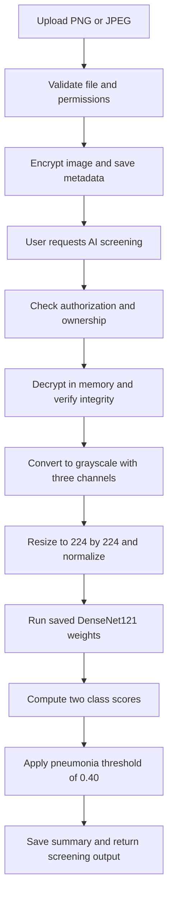

# Model execution and hardware guide

Verified against this checkout and the local environment on 9 November 2026. These observations describe the current implementation; they do not establish clinical accuracy or production capacity.

## What the application actually does

The backend runs a previously trained **DenseNet121 image classifier** from `models/densenet121_pneumonia_best.pth`. It performs a new prediction on each screening request using the saved weights. It does not train a new model for each upload, search the training dataset for a matching image, or call an external AI service.

There are two separate stages:

1. **Training, performed separately:** the training code starts with Torchvision's ImageNet-pretrained DenseNet121, replaces the classifier with a two-class head, and fine-tunes it using labeled images. The saved checkpoint records `pretrained: true`, classes `NORMAL` and `PNEUMONIA`, and best epoch 5. Torchvision documents the default pretrained weights as ImageNet weights, rather than pneumonia-specific weights. [Torchvision DenseNet121 documentation](https://docs.pytorch.org/vision/stable/models/generated/torchvision.models.densenet121.html)
2. **Inference, performed by the running app:** the backend reconstructs the architecture and loads the saved pneumonia checkpoint once at startup. Each screening request runs a forward pass without gradient computation or weight updates. Uploading more images does not make the model learn automatically.

The checkpoint is approximately **27.13 MiB** and the reconstructed two-class model has **6,955,906 parameters**. Checkpoint size alone does not determine RAM or VRAM needs: the framework, intermediate tensors, operating system, browser, and frontend tools also consume memory.

## What happens to an uploaded image



The pneumonia score at or above **0.40** produces `PNEUMONIA`; below that threshold produces `NORMAL`. This is a tuned decision threshold, not a 40% accuracy claim. The displayed confidence is the score for the selected class, so it can be below 50% when the pneumonia class is selected. Model scores are not established patient disease probabilities or a substitute for clinical interpretation.

Image validation currently checks image decoding, format, and dimensions. **It does not establish that the image is a chest X-ray.** A valid ordinary photograph can pass these checks and receive an unsuitable prediction. Input suitability and evaluation on unseen patients need attention during the backend review.

Implementation references: [startup](../src/api/main.py), [inference engine](../src/api/model_service.py), [training script](../src/train_model.py), and [training settings](../configs/train_config.json).

## CPU or GPU?

The inference engine defaults to `PULMOSCAN_DEVICE=auto`: it probes CUDA execution and warms up the actual model, preferring a working GPU and falling back to CPU if CUDA cannot initialize. `cpu` forces CPU; `cuda` requires CUDA and reports failure instead of falling back. The training script separately selects CUDA when `torch.cuda.is_available()` is true, otherwise CPU. CPU work still includes request handling, image decoding, encryption, and database operations even when model computation uses CUDA.

| Operation | CPU-only installation | With a compatible CUDA-enabled installation |
| --- | --- | --- |
| Prediction | CPU | NVIDIA GPU for model computation |
| Explicit training script | CPU, if a dataset is provided | NVIDIA GPU for model computation |
| Normal uploads | Validation, encryption, and storage; no training | Same workflow; no training |

The saved checkpoint's tensor storage tags are `cuda:0`. This shows the tensors were saved from a CUDA device; it does not identify the original GPU model or prove every historical training step used that device. The checkpoint metadata does not establish the teammate's exact training hardware.

The configured training dataset directory, `data/model_data`, is absent in this checkout. Prediction can use the existing checkpoint without that dataset; reproducing training requires the data and a verified train/validation/test split.

## Verified local laptop before GPU setup

| Item | Observed value |
| --- | --- |
| CPU | Intel Core i5-11400H, 6 cores / 12 threads |
| RAM | Approximately 16 GB installed |
| GPU | NVIDIA GeForce GTX 1650, 4 GB VRAM |
| PyTorch | `2.5.1+cpu` |
| PyTorch CUDA runtime | None |
| `torch.cuda.is_available()` | `False` |
| Actual model device | `cpu` |

**This machine is sufficient for local development and single-image CPU inference. No hardware upgrade is needed to continue.** The stated 512 GB drive capacity is ample in principle; available free space is what matters for dependencies and datasets.

The GTX 1650 supports CUDA, as confirmed by NVIDIA. The initially installed CPU-only PyTorch package could not use it. Enabling GPU execution requires a compatible PyTorch/torchvision CUDA build and driver; installing the standalone CUDA Toolkit alone does not turn a CPU-only PyTorch package into a GPU-enabled one. The official PyTorch archive lists matching `torch==2.5.1` / `torchvision==0.20.1` CPU and CUDA builds. [NVIDIA GTX 1650 CUDA confirmation](https://forums.developer.nvidia.com/t/does-gtx-1050ti-or-1650-for-notebook-support-tensorflow-gpu/77384/2), [PyTorch version/build matrix](https://pytorch.org/get-started/previous-versions/)

This table records the initial CPU-only environment. The [README](../README.md#gpu-compatibility-and-automatic-cpu-fallback) and hardware-aware `scripts/setup_compute.py --install` now provide CPU/CUDA dependency selection. Run `scripts/check_compute.py --model` with the project interpreter to report the current device and verify the checkpoint offline. Installing dependencies is explicit; launching the app never installs packages or drivers. Model weights and encryption keys are preserved.

### Local CPU timing sample

An offline check used the actual inference engine, a synthetic 224-by-224 grayscale PNG, three warm-up calls, and ten measured calls with six PyTorch CPU threads:

| Measurement | Result |
| --- | --- |
| Median | 80.9 ms |
| Minimum / maximum | 70.5 / 91.1 ms |

These measurements include image validation, preprocessing, and prediction. They exclude HTTP, encryption/decryption, database work, frontend rendering, and initial model loading. A synthetic image is **not an accuracy test**. Real images, power settings, thermal limits, concurrent work, and cold startup can change latency. Earlier CPU/GPU timings elsewhere in the repository describe other runs, not this laptop's measured performance.

## Verified after hardware-aware setup

On the same laptop, `scripts/setup_compute.py --install` successfully replaced the CPU-only packages with the CUDA 12.4 profile:

| Check | Observed result |
| --- | --- |
| PyTorch / torchvision | `2.5.1+cu124` / `0.20.1+cu124` |
| Packaged CUDA runtime | 12.4 |
| Automatic device selection | `cuda:0`, NVIDIA GeForce GTX 1650, 4.0 GiB VRAM |
| Real checkpoint smoke test | Prediction completed on `cuda:0` |
| Forced CPU smoke test using the same CUDA-enabled packages | Prediction completed on `cpu` |
| Package consistency | `pip check` passed |
| Combined development preflight | `npm.cmd run dev:check` passed and reported `cuda:0` |

The smoke tests used synthetic images and establish execution, not diagnostic accuracy. No frontend/backend servers, training, driver installation, model-weight changes, or encryption-key changes were involved. Other GPU families and Linux profiles are selected and covered by simulated tests but have not been physically validated on this laptop. The CUDA wheel download was approximately 2.5 GB on Windows; allow time and disk space for download, extraction, and caching.

## Practical hardware starting points

These are engineering estimates for a small local demo, **not tested hard minimums or server sizing guarantees**. Lower-spec machines may work; concurrent users require separate load testing.

| Use | CPU | System RAM | GPU | Storage planning |
| --- | --- | --- | --- | --- |
| CPU prediction and local development | Modern 4-core x86-64 processor or better | 8 GB starting point; 16 GB preferred with browser and frontend tools | Not required | Allow 20 GB free for tools, packages, and caches; add image storage |
| GPU prediction and local development | Similar CPU | 16 GB preferred | Compatible NVIDIA CUDA GPU with about 4 GB VRAM; see the README compatibility matrix | Allow 30 GB free for tools, CUDA packages, and caches; add image storage |
| Training / fine-tuning experiments | Modern 4–6 cores or better | 16 GB starting point; 32 GB more comfortable | Existing 4 GB GPU may work with reduced batches; 8–12 GB VRAM gives more room | Allow 30 GB for tools/caches/checkpoints, plus the actual dataset |

CPU training is supported by the code but can take substantially longer; no epoch-duration estimate has been measured here. A newer GPU is optional. As examples of roomier desktop cards, NVIDIA lists RTX 4060 with 8 GB and an RTX 3060 variant with 12 GB; these are capacity examples, not a purchase recommendation. Laptop variants can differ. [NVIDIA graphics card specifications](https://www.nvidia.com/en-us/geforce/graphics-cards/compare/)

The current training configuration uses **batch size 16 at 224-by-224**. It has not been tested on this 4 GB GPU and may run out of VRAM. A later GPU trial should start with a small batch such as 2, measure peak memory, and adjust. Very small training batches can also require special handling of batch normalization. Prediction uses one image at a time and needs less memory than training because it does not retain gradients and optimizer state. System RAM and GPU VRAM are separate resources; 16 GB RAM does not make a 4 GB GPU into a 16 GB GPU.

## Next backend review

Before changing architecture or training again, review these in order:

1. Reproduce CPU behavior with representative X-rays; then evaluate a compatible CUDA environment and compare latency, memory use, and outputs on this laptop.
2. Validate dataset provenance, patient separation, independent test performance, and threshold/calibration choices. Repository metrics alone do not establish real-world accuracy.
3. Handle unsuitable images, malformed inputs, inference concurrency, checkpoint trust, and useful failure reporting.
4. Decide whether retraining is justified by evaluation results. Faster hardware alone does not improve the learned model's accuracy.

Services remain under manual control. From the project root, start both only when ready to review:

```powershell
npm.cmd run dev
```

For environment creation and installation steps, use [the local setup guide](LOCAL_SETUP.md).
